# Ինչպես է կառուցված կայքը (apostolic.am)

Այս ֆայլը կայքի ամբողջական քարտեզն է՝ ինչից է բաղկացած, ինչպես են մասերը կապված, ինչ սկզբունքով է աշխատում։
Սխեմաները գրված են **Mermaid** լեզվով. GitHub-ը դրանք ինքն է նկարում, իսկ ցանկացած սխեմա կարելի է պատճենել
https://mermaid.live էջ և այնտեղ մեծացնել, խմբագրել, պահել որպես նկար։

> Կանոն բոլոր չատերի համար. նոր հնարավորություն, աղյուսակ, էջ կամ ծառայություն ավելացնելիս թարմացնել այս ֆայլը
> նույն ճյուղում (տես CLAUDE.md)։ Վերջին թարմացումը՝ 2026-11-02։

## Բովանդակություն
1. [Մեծ պատկերը](#1-մեծ-պատկերը)
2. [Ինչ տեխնոլոգիաներ են օգտագործված](#2-ինչ-տեխնոլոգիաներ-են-օգտագործված)
3. [Ինչպես է բացվում մեկ էջ](#3-ինչպես-է-բացվում-մեկ-էջ)
4. [Նյութերը. Telegram-ից կայք](#4-նյութերը-telegram-ից-կայք)
5. [Էջերի քարտեզը](#5-էջերի-քարտեզը)
6. [Մուտք և հաշիվներ](#6-մուտք-և-հաշիվներ)
7. [Որոնում](#7-որոնում)
8. [Կարդացել եմ / Լսել եմ / Օրացույց](#8-կարդացել-եմ--լսել-եմ--օրացույց)
9. [Հիշեցումներ](#9-հիշեցումներ)
10. [Կիրակնօրյա հարց և «Իմ տարին»](#10-կիրակնօրյա-հարց-և-իմ-տարին)
11. [Սրբավայրեր և քարտեզ](#11-սրբավայրեր-և-քարտեզ)
12. [Բոտը](#12-բոտը)
13. [Բառարան](#13-բառարան)
14. [Պահված նյութեր, համարներ, հարցումներ](#14-պահված-նյութեր-համարներ-հարցումներ)
15. [Կառավարում (ադմին)](#15-կառավարում-ադմին)
16. [Ժամացույց (Clock) և cron-ներ](#16-ժամացույց-clock-և-cron-ներ)
17. [Հղումների նախադիտման քարտեր](#17-հղումների-նախադիտման-քարտեր)
18. [Բազա (D1). բոլոր աղյուսակները](#18-բազա-d1-բոլոր-աղյուսակները)
19. [Պահեստ (R2)](#19-պահեստ-r2)
20. [Միջավայրեր և թողարկում](#20-միջավայրեր-և-թողարկում)
21. [GitHub Actions](#21-github-actions)
22. [Արագություն և խնայողություն](#22-արագություն-և-խնայողություն)
23. [Թղթապանակների քարտեզը](#23-թղթապանակների-քարտեզը)
24. [Կարևոր բանաձևեր և ֆունկցիաներ](#24-կարևոր-բանաձևեր-և-ֆունկցիաներ)
25. [Ինչպես փոխել. բաղադրատոմսեր](#25-ինչպես-փոխել-բաղադրատոմսեր)
26. [Բառարան՝ նոր մարդու համար](#26-բառարան-նոր-մարդու-համար)

---

## 1. Մեծ պատկերը

Կայքը չունի սովորական սերվեր։ Ամեն ինչ աշխատում է **Cloudflare**-ում (Worker՝ կոդը, D1՝ բազան, R2՝ ֆայլերը)։
Նյութերի աղբյուրը **Telegram խումբն** է. GitHub-ը պարբերաբար դրանք պատճենում է կայք։

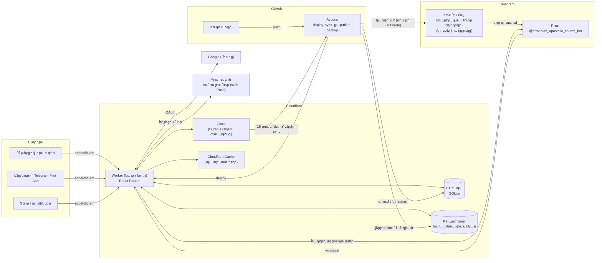

**Սկզբունքը**
- Ընթերցողը երբեք ուղիղ Telegram-ից չի կարդում. ամեն ինչ արդեն կա D1-ում և R2-ում, դրա համար արագ է։
- Worker-ը ամեն հարցման համար աշխատում է Cloudflare-ի մոտակա կետում (Եվրոպա, Երևանին մոտ)։
- Ամեն ինչ անվճար փաթեթի մեջ է. դրա համար շատ տեղ կա խնայողության հնարքներ (բաժին 22)։

## 2. Ինչ տեխնոլոգիաներ են օգտագործված

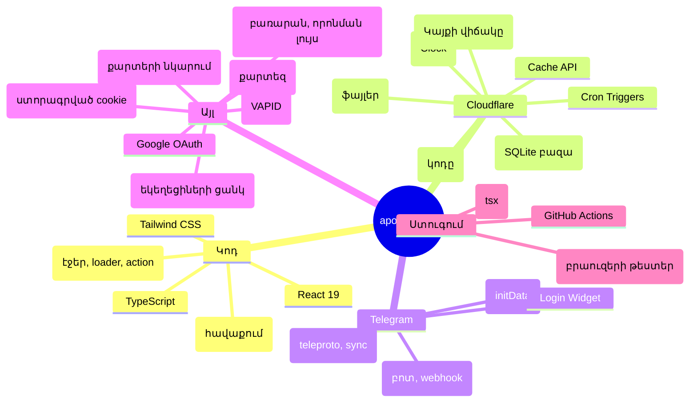

| Ինչ | Ինչի համար |
| --- | --- |
| **React Router v7** | Ամեն էջ՝ `app/routes/*.tsx` ֆայլ. `loader`-ը բերում է տվյալը սերվերում, `action`-ը ընդունում է ձևերը։ Էջը պատրաստվում է սերվերում (SSR), հետո բրաուզերում «կենդանանում» է։ |
| **Cloudflare Worker** | Կայքի ամբողջ սերվերը (`workers/app.ts`)։ Չկա VPS, չկա մշտական սերվեր։ |
| **D1** | SQLite բազա ամպում. նյութեր, մարդիկ, նշումներ, հիշեցումներ, սրբավայրեր… (բաժին 18)։ |
| **R2** | Ֆայլեր. ձայնագրություններ, տեսանյութեր, նկարներ, քարտեր, որոնման ինդեքս (բաժին 19)։ |
| **Durable Object «Clock»** | Միակ «զարթուցիչը». արթնանում է ճիշտ րոպեին (sync, հիշեցումներ, կիրակնօրյա ծանուցում)։ |
| **teleproto (MTProto)** | GitHub Actions-ում կարդում է Telegram խմբի ամբողջ պատմությունը (բոտը դա չի կարող)։ |
| **MapLibre** | Սրբավայրերի քարտեզը։ |
| **satori + resvg** | Ամեն նյութի հղման նախադիտման նկարը (բաժին 17)։ |

## 3. Ինչպես է բացվում մեկ էջ

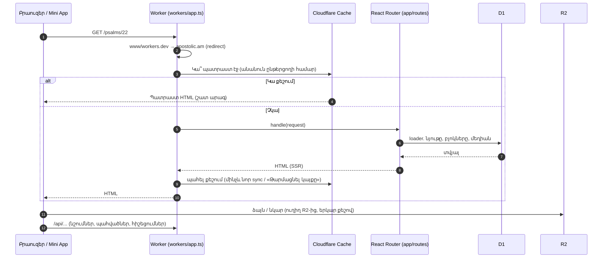

- **Կայքի լուսավորություն (թեմա), տառաչափ, շարժում** (`app/utils/preferences.ts`, `theme.ts`). պահվում են բրաուզերում, էջը բացվում է արդեն ճիշտ գույնով (առանց «թարթման»)։
- **Մոմի ներածություն** (`candle-loader.tsx`). միայն այցի առաջին բացումից։ Մոմի տակ տառ առ տառ ոսկեգույն գրվում է «…Ես ձեզ հետ եմ բոլոր օրերին, / մինչև աշխարհի վախճանը» (Մատթ. 28:20՝ Էջմիածնի Աստվածաշնչից, `VERSE_LINES`), ստորակետից հետո դադար, վերջին տառից 0,5 վրկ հետո լույսը բացում է էջը (ընդհանուր ~6 վրկ)։
- **Էջերի քեշ հեռախոսում** (`navigation-cache.ts`, `search-state.ts`). հեռախոսը պահում է էջերը, մինչև կայքի «բովանդակության տարբերակը» փոխվի (`/api/content-version`)։

## 4. Նյութերը. Telegram-ից կայք

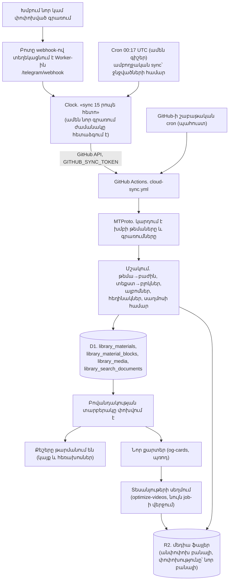

**Տեսանյութերի ավտոմատ սեղմում** (`scripts/optimize-videos.ts`, կանոնները՝ `shared/video-optimize.ts`, աղյուսակ՝
`video_optimizations`)։ `cloud-sync.yml`-ի վերջին քայլն է, ուստի աշխատում է ամեն sync-ից հետո (նոր գրառումից 15 րոպե հետո
և ամեն գիշեր)։ Գտնում է դեռ չսեղմված տեսանյութերը՝ Telegram-ից (`library_media`, kind='video'), կայքում ավելացված
(`material_attachments`), սրբավայրերի (`places.video_url`) և օգնության (`site_settings.help_videos`)։ Ամեն մեկը
սեղմվում է ffmpeg-ով **MP4 / H.264 High 4.0 / AAC** ձևաչափով (նվագարկվում է հին և նոր բոլոր հեռախոսներում և
նոութբուքերում). CRF 26, կարճ կողմը ≤720, ≤30 կադր/վրկ, ձայնը՝ մոնո 64k (եթե ալիքները նույնն են) կամ ստերեո 96k,
`faststart`։ Փոխարինվում է միայն եթե ≥15%-ով փոքր է (կամ եթե բնօրինակը ոչ բոլոր սարքերում է նվագարկվում՝ HEVC, WebM)։
- Telegram-ի և կայքի ֆայլերը՝ **նույն բանալիով** (այդպես sync-ը դրանք նորից չի բերում). D1-ում թարմանում են
  `size_bytes`, `mime_type`, `r2_etag` (`?v=`-ը փոխվում է, քեշը հինը չի տալիս)։ Sync-ը գրառումը վերագրելիս այս
  երեքը վերցնում է `video_optimizations`-ից։ Բնօրինակը՝ `originals/<բանալի>`, ջնջվում է 14 օր հետո։
- Սրբավայրի և օգնության ֆայլերը՝ նոր բանալի `…-o.mp4`, հղումը փոխվում է միայն եթե ադմինը միջանկյալ չի փոխել. հին
  ֆայլը ջնջվում է 14 օր հետո։
- Ամեն քայլ գրանցվում է (`pending` → `optimized` / `kept`), ընդհատվածը շարունակվում է, ոչինչ երկու անգամ չի սեղմվում։
  Մեկ աշխատանքի ժամանակը՝ `video_minutes` (լռելյայն 40 րոպե), մնացածը՝ հաջորդ անգամ։ ffmpeg-ը տեղադրվում է միայն
  երբ նոր տեսանյութ կա։ Արդյունքը՝ Կառավարում → Կայքի վիճակը → «Ինչով է լցված պահեստը»։

**Բաժիններ** (Telegram-ի թեմաներ → կայքի բաժիններ, `material-path.ts`). Սաղմոսներ (`/psalms`), Աղոթքներ (`/pray`),
Սրբերի վարք (`/saints`), Ավետարանի ուսուցում (`/gospel`), Օրվա ընթերցումներ (`/daily`), Հարցեր Աստվածաշնչից (`/questions`),
գրառումներ (`/post`)։ Հին հասցեները (`/pray_364`) 301-ով տանում են նորերին։

**Նյութի էջը** (`material.tsx`). տեքստ (`rich-text`, `telegram-content`), մեդիա (`material-media`), սաղմոսի տող առ տող
ընթերցում ձայնի հետ (`psalm-read-along`, `psalm_timings`), նախորդ/հաջորդ սաղմոս, կիսվել, պահել, «Կարդացել եմ»,
հիշեցում, բառարանի բառեր, հարցման քվեարկություն։ Կայքում ավելացված ձայնագրություններ (`material_attachments`),
երբ Telegram-ը չի կարող (երկար տեքստ)։

## 5. Էջերի քարտեզը

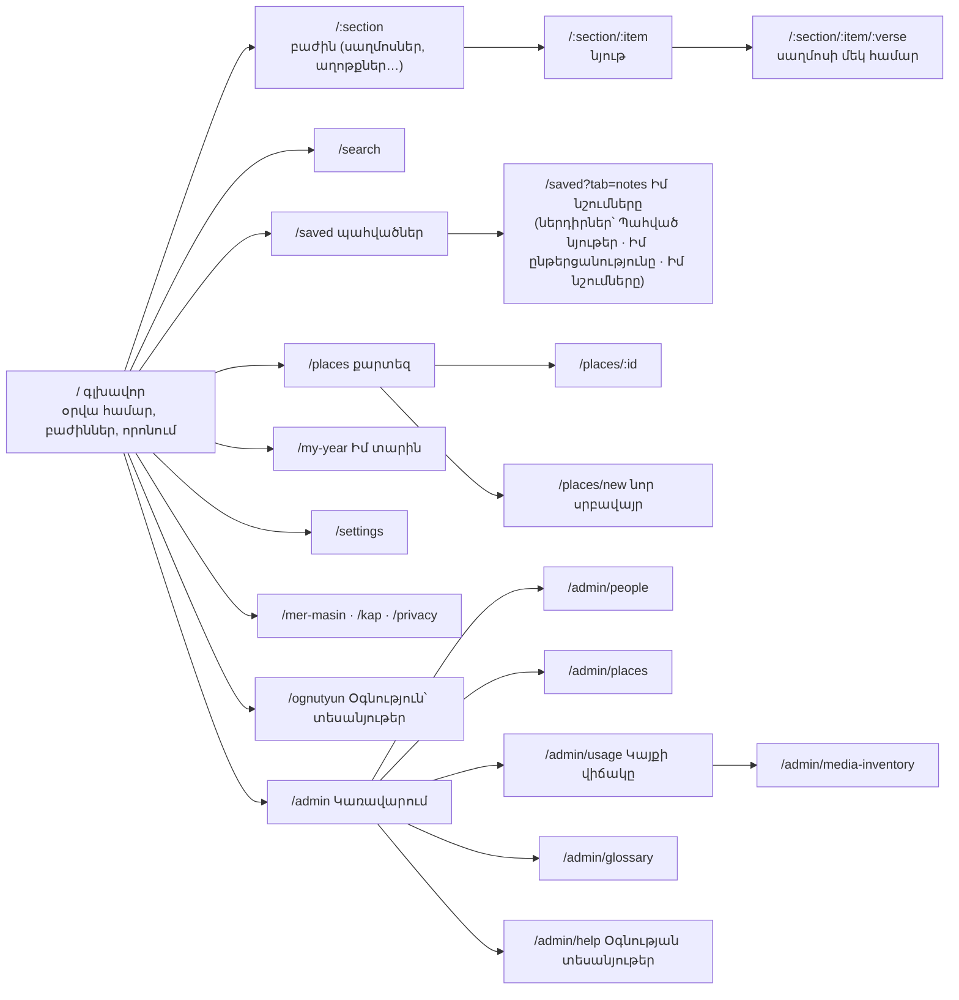

**API-ներ** (բրաուզերը կանչում է ֆոնում).
`/api/search-page`, `/api/search-suggestions`, `/api/search-index`, `/api/content-version`, `/api/reading-log`,
`/api/reminders`, `/api/calendar`, `/api/push`, `/api/saved-verses`, `/api/poll-vote`, `/api/psalm-timings`,
`/api/presence`, `/api/highlights`, `/api/church-points`, `/api/place-visits`, `/api/places-search`, `/api/glossary`, `/api/sunday`, `/api/my-summary`,
`/api/share-prepare`, `/api/telegram-link`, `/api/og-cards`, `/api/categories/:slug/posts`, `/api/help-videos`։
**Ֆայլեր**. `/media/...` (R2-ի պահուստային ճանապարհ), `/place-media/...`, `/help-media/...`, `/og/card/...`, `/sitemap.xml`։

## 6. Մուտք և հաշիվներ

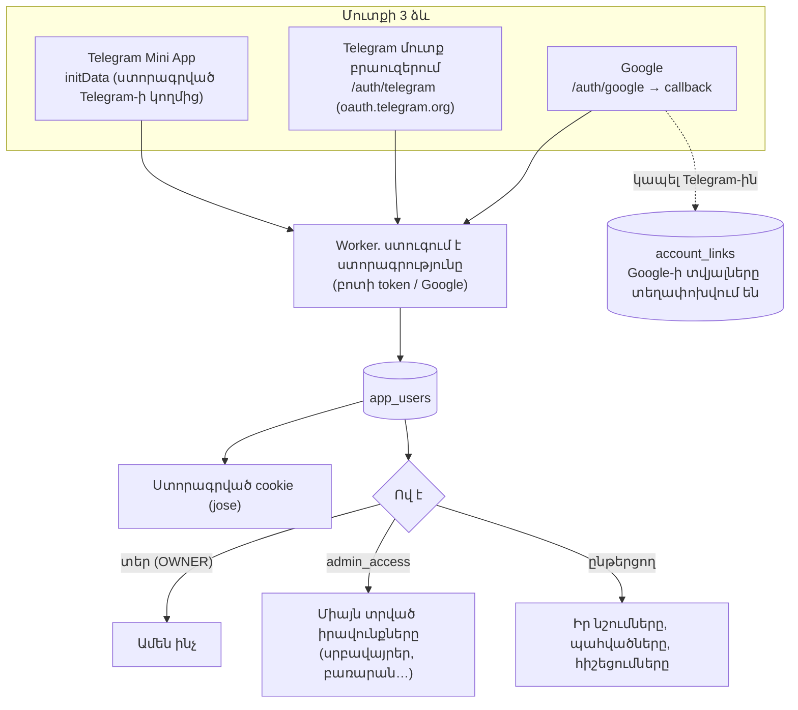

- Մուտք չգործած ընթերցողը կարդում է ամեն ինչ. մուտքը պետք է միայն անձնական բաների համար։
- **Այցերի վիճակագրությունը անանուն է** (`site_presence`). հաշվի հետ չի կապվում։

## 7. Որոնում

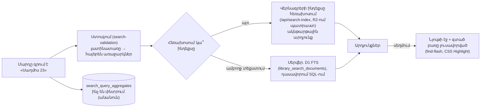

Էջի ներսում որոնում (`page-find.tsx`). բաժնի ցուցակը նեղանում է մուտքագրելիս։

## 8. Կարդացել եմ / Լսել եմ / Օրացույց

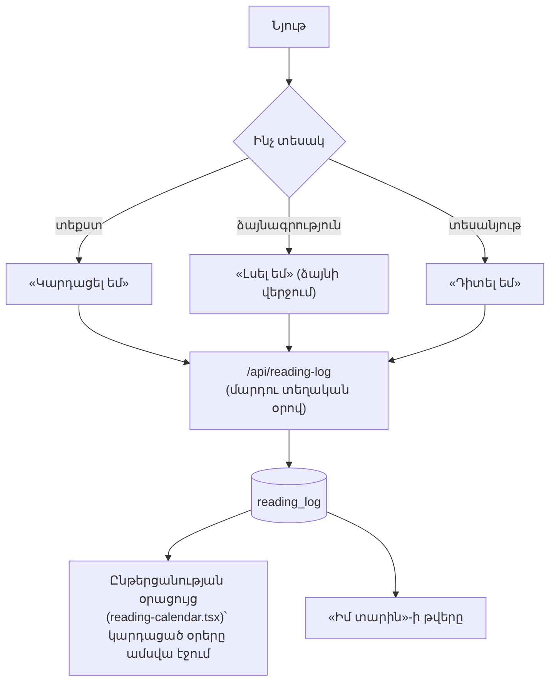

## 9. Հիշեցումներ

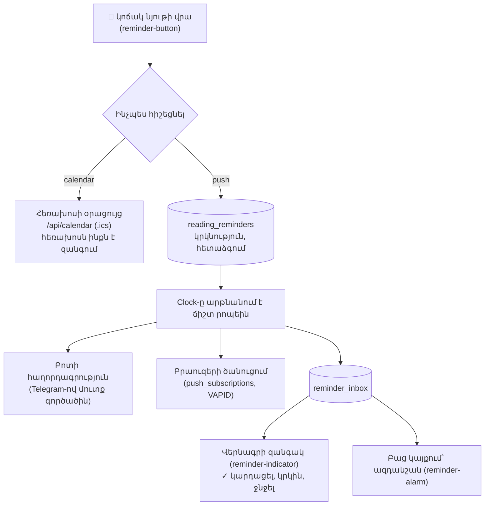

## 10. Կիրակնօրյա հարց և «Իմ տարին»

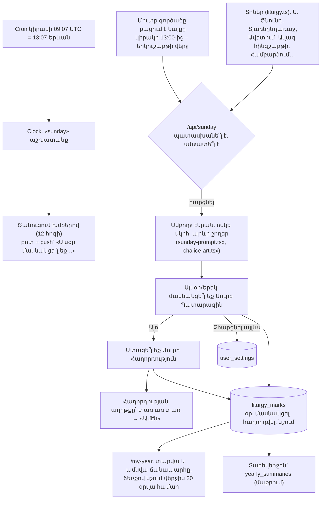

## 11. Սրբավայրեր և քարտեզ

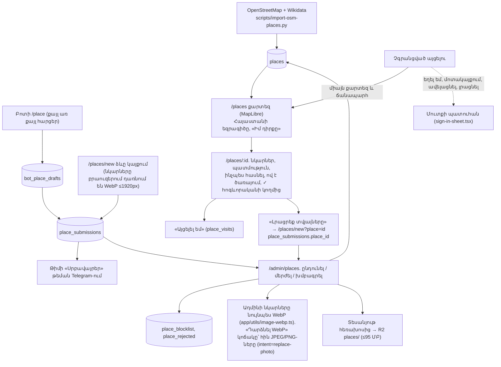

**Ճանապարհը և մուտքը** (`places.accessibility`)՝ 4 հարց, նույնը բոտում և կայքի ձևում (`ACCESS_PARTS`, `app/utils/place-answers.ts`)․
🚗 Մեքենայով հասանելիություն, 🪨 Ճանապարհ, ♿ Թեքահարթակ, 🚪 Մուտք։ Ամեն պատասխան՝ իր տողով («Թեքահարթակ՝ առկա է»),
նշանները ավելացվում են ցուցադրելիս (`readAccess`, `accessText`)։ Հին «Ճանապարհը՝ …», «Մուտքը՝ …» տողերը նույնպես ցույց են տրվում։
- Քարտեզի քարտիկում՝ «Կիսվել» կոճակ (`ShareButton`). կիսվում է `/places/<id>` էջի հղումը։


## 12. Բոտը

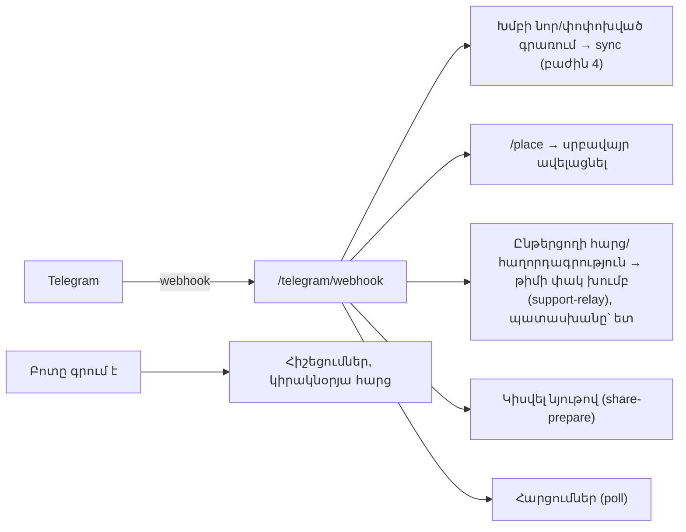

## 13. Բառարան

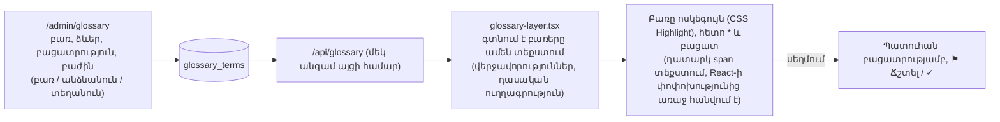

## 14. Պահված նյութեր, համարներ, հարցումներ

| Ինչ | Աղյուսակ | Որտեղ է երևում |
| --- | --- | --- |
| Պահված նյութեր և նշումներ | `saved_materials` | `/saved` |
| Սաղմոսի համարի «Նշել» | `highlights` (`verse` սյունակ). հին `saved_verses`-ը տեղափոխվեց (migration 0048) և այլևս չի գրվում | համարի պատուհան, «Իմ նշումները» |
| Նշումներ տեքստում (պահված խոսք, ❓ հարց, սմայլիկ, նոթ, պատասխան) | `highlights` | ամեն նյութի տեքստում, «Իմ անկյունը» → «Իմ նշումները» |
| Հարցման ձայներ | `poll_votes` | Telegram-ի հարցումները կայքում |
| Սաղմոսի ժամանակացույց (տող↔ձայն) | `psalm_timings` | տող առ տող ընթերցում |
| Օրվա համար | `daily-verses.ts` | գլխավոր էջ |
| Տեղադրել որպես հավելված (PWA) | — | `install-prompt.tsx` |

### Նշումներ տեքստում (highlights)

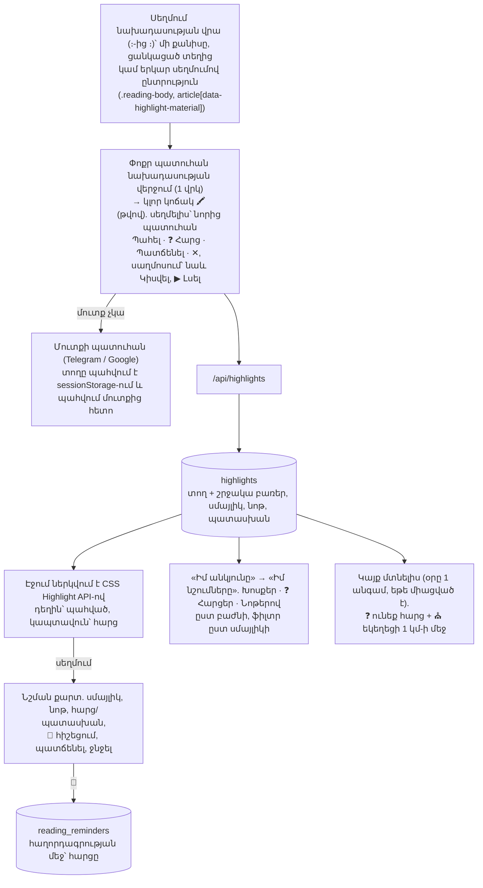

- Մեկ սեղմման դեպքում Android Chrome-ի «Touch to Search» (Google-ի ներքևի պատուհան) չպետք է բացվի. էջը փոխվում է հենց սեղմման պահին (`flushSync`)։ Երկար սեղմումով ընտրության դեպքում վահանակը մնում է նաև ընտրությունը մաքրվելուց հետո։
- Նախադասության սահմանները՝ `sentenceAt`. վերջակետից վերջակետ (`։ : ! ? …`), «.» միջակետը, «՞»-ն և պարզ նոր տողը վերջ չեն, վերնագրերը՝ կոշտ սահման (`\u2029`, `buildTextMap`)։ Սաղմոսի համարը («3 ») տողի մեջ չի մտնում։
- Նշման քարտում նշումը (և պատասխանը) պահվում է «Պահել» կոճակով։ Սմայլիկը՝ մեկ հատ (`cleanEmoji`, `firstEmoji`)։ Որոնման էջը մուտք գործածի համար ցույց է տալիս նաև «Իմ նշումները» (`/api/highlights?q=`)։
- Պատուհանում «Հարց» չկա (նշումը «Հարցեր» է տեղափոխվում նշման քարտից՝ «Տեղափոխել «Հարցեր»»)։ Մուտք չգործածի համար նախ բացվում է մուտքը, նշելու պատուհանը փակվում է։ Բացվելը/փոքրանալը՝ `highlight-pop` / `highlight-pop-out` անիմացիաներով (transform-origin՝ նախադասության վերջը)։
- Պատուհանը 1 վայրկյան հետո դառնում է կլոր կոճակ (`COLLAPSE_MS`), հաջորդ նշումները այն չեն բացում, միայն կոճակի վրա սեղմելը։ Էջը փոխելիս կամ տեքստից դուրս սեղմելիս ընտրվածը չեղարկվում է։ Նշման քարտում «Ջնջել»-ը միանգամից է, մարդու ավելացրած սմայլիկները (✓/✕) մնում են արագ ցանկում (`localStorage` `my-emojis`)։
- Մի քանի նախադասություն (`toggleSentence`). պահելիս կպածները դառնում են մեկ նշում (`mergeSpans`), մնացածը՝ առանձին։
- Սաղմոսի հին համարի պատուհանը (`VersePopup`) հանված է. «▶ Լսել»-ը ուղարկում է `psalm-listen` իրադարձություն `psalm-read-along.tsx`-ին, «Կիսվել»-ը՝ համարի էջի հղումը։
- «Իմ անկյունը» (`/saved`)՝ 3 ներդիր (`?tab=saved|reading|notes`, վերջինը հիշվում է). `/notes`-ը 301-ով տանում է `/saved?tab=notes`։
- Տողը գտնվում է իր տեքստով և 32 նշան առաջ/հետո (`app/utils/highlights.ts` `findQuote`). նյութը փոխվելիս նշումը մնում է `/notes`-ում։
- Բառարանի կետագիծը և նշման ետնագույնը իրար չեն խանգարում. կարճ սեղմումը բառարանի բառի վրա բացում է բառարանը, և այնտեղ կա «📌 բացել նշումը»։
- Եկեղեցու հուշումը քարտ է վերևում (մնում է, մինչև փակեն, թեթև թրթռոցով). «Դեպի եկեղեցի»-ն բացում է նկարը, անունը, Google Maps / Yandex ճանապարհը։ Դիրքը չի գնում կայք, `/api/church-points`-ից եկեղեցիների ցանկը բեռնվում է, և հեռավորությունը հաշվում է բրաուզերը (`components/church-nudge.tsx`)։ Միացնում է մարդը `/notes`-ի «Հարցեր» ներդիրում։
- Մեկ մարդուն՝ մինչև 2000 նշում, տողը՝ մինչև 1200 նշան։

### «Որտեղ էիք կանգնել» (վերջին կարդացածը/լսածը)

- `components/continue-reading.tsx`. `PlaceTracker` (root-ում, **միայն մուտք գործածների համար**) նյութի էջում 8 վայրկյանից կամ ձայնը/տեսանյութը միացնելուց հետո հիշում է բաժինը, հասցեն, անունը, «կարդացել/լսել/դիտել», որքան էր թերթել և տեսանյութի վայրկյանը (`utils/last-place.ts`, `localStorage` `last-places`, այս սարքում, 60 օր)։
- `ContinueCard`՝ միայն բաժնի էջում (գլխավոր էջում՝ ոչ)։ Քարտի մարմինը՝ ցանկում իջնում է մինչև այդ նյութը և վառում այն (տեսանյութի դեպքում՝ բացում է էջը, տեսանյութը պատրաստ է նույն րոպեից), սլաքը՝ բացում է նյութը նույն տեղից (տեսանյութը՝ միանգամից շարունակվում է)։
- Ելքի ժամանակ (և երբ մարդն այլևս մուտք գործած չէ) անձնական տվյալները մաքրվում են սարքից՝ `utils/personal-storage.ts` (`clearPersonalStorage`)։ Service worker-ը անձնական API-ները (`/api/highlights` և այլն) չի պահում։
- Չեն հիշվում՝ «Օրվա ընթերցումներ» (`daily`) և սրբավայրեր։ Բաժինը հասցեի առաջին մասն է, ուստի ապագա Աստվածաշունչը կաշխատի նույն ձևով։

## 15. Կառավարում (ադմին)

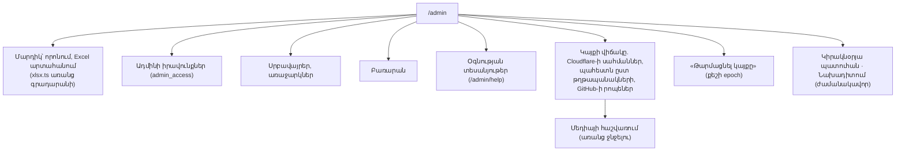

### Օգնություն (ուսուցողական տեսանյութեր)

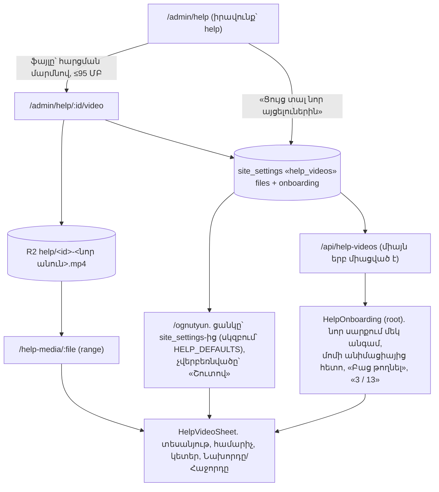

- Ցանկը (վերնագրեր, կարգ) ադմինն է խմբագրում `/admin/help`-ում՝ ավելացնել, անվանել, ↑↓, «Հանել ցանկից» (տեսանյութն էլ է ջնջվում)։ Պահվում է `site_settings.help_videos.items`-ում. մինչ առաջին խմբագրումը՝ `HELP_DEFAULTS` (`app/utils/help-videos.ts`)։ Նոր տարրի id-ն՝ `v-…`։
- Նոր ֆայլը ստանում է նոր անուն, նախորդը R2-ից ջնջվում է (`setHelpVideo`), ուստի `/help-media/`-ը քեշվում է անվերջ։
- Ուղեցույցը ցույց է տրվել՝ `localStorage` `help-onboarding-seen` (այս սարքում)։ Չի բացվում `/admin`, `/auth`, `/ognutyun` էջերում։
- Տեսանյութերը պատրաստվում են `scripts/video-guides/`-ով (README)։

## 16. Ժամացույց (Clock) և cron-ներ

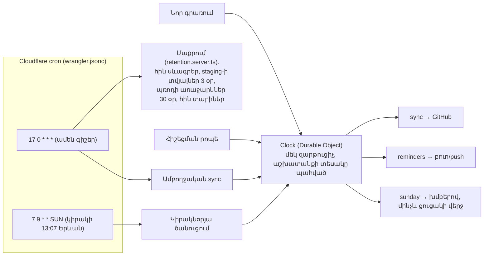

Ոչինչ չի աշխատում «ամեն րոպե». Clock-ը արթնանում է միայն այն պահին, երբ գործ կա (անվճար սահմանը օրական 100 000 հարցում է)։

## 17. Հղումների նախադիտման քարտեր

Երբ նյութի հղումն ուղարկում ես Telegram-ով, WhatsApp-ով, Facebook-ով, հղման տակ երևում է **նկար-քարտ**
(վերնագիր, տեքստի կտոր, խորհրդանիշ)։ Դա «Link-preview card» (Open Graph նկար) է։

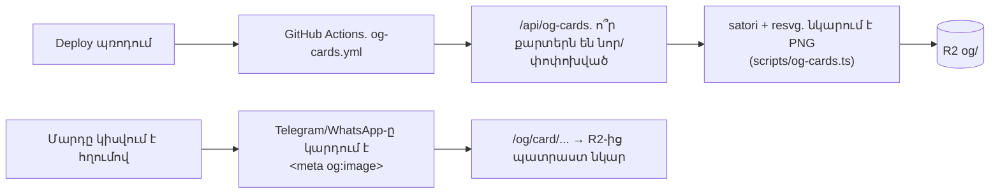

Նկարվում է GitHub-ում, որովհետև մեկ քարտը ~1 վայրկյան CPU է ուզում, իսկ անվճար Worker-ին թույլատրված է շատ ավելի քիչ։
Նկարվում են միայն նոր կամ փոփոխված քարտերը։ 2026-11-02-ից՝ միայն պռոդի deploy-ից հետո։

### Նկարով կիսվել (9:16)

Նյութի էջում, սաղմոսի համարի էջում և համարի պատուհանում «Կիսվել»-ը բացում է պատուհան՝ նյութի
**ուղղահայաց նկարով** (1080×1920, Instagram/Telegram-ի պատմությունների չափը)՝ մագաղաթ, ոսկե շրջանակ,
խաչ, բաժին, վերնագիր, տեքստի կտոր, ներքևում աննկատ «apostolic.am»։ Կոճակներ՝ «Կիսվել նկարով»
(հեռախոսի կիսվելու պատուհան, նկարը՝ ֆայլ), «Պահել նկարը», «Հղումով» (նախկին կիսվելը)։

Նկարվում է **հեռախոսում** (canvas, `app/utils/story-image.ts`), ոչ թե սերվերում. սաղմոսի ամեն
համարի համար նախապես նկարել հնարավոր չէ, իսկ Worker-ում satori-ն շատ CPU է ուզում։
Պատուհանը՝ `app/components/story-share-sheet.tsx`, միացված է `ShareButton`-ի `story` հատկությամբ։

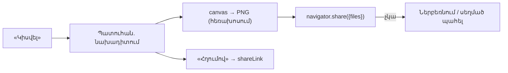

## 18. Բազա (D1). բոլոր աղյուսակները

```mermaid
erDiagram
  app_users ||--o{ saved_materials : "պահում է"
  app_users ||--o{ saved_verses : "պահում է"
  app_users ||--o{ highlights : "նշում է"
  app_users ||--o{ reading_log : "նշում է"
  app_users ||--o{ reading_reminders : "դնում է"
  app_users ||--o{ reminder_inbox : "ստանում է"
  app_users ||--o{ push_subscriptions : "բրաուզերներ"
  app_users ||--o{ poll_votes : "քվեարկում է"
  app_users ||--o{ place_visits : "այցելել է"
  app_users ||--o{ liturgy_marks : "Պատարագ"
  app_users ||--o| user_settings : "կարգավորումներ"
  app_users ||--o{ yearly_summaries : "տարվա ամփոփում"
  app_users ||--o{ account_links : "Google↔Telegram"
  app_users ||--o| admin_access : "իրավունքներ"
  app_users ||--o{ place_submissions : "առաջարկում է"
  library_topics ||--o{ library_materials : "բաժին"
  library_materials ||--o{ library_material_blocks : "տեքստի բլոկներ"
  library_materials ||--o{ library_media : "մեդիա"
  library_materials ||--o{ material_attachments : "կայքից ավելացված"
  library_materials ||--|| library_search_documents : "որոնում"
  library_materials ||--o{ psalm_timings : "տող↔ձայն"
  places ||--o{ place_visits : ""
  places ||--o{ place_submissions : "փոփոխություններ"
```

| Խումբ | Աղյուսակներ |
| --- | --- |
| **Գրադարան** (sync-ը լցնում է) | `library_sources`, `library_topics`, `library_materials`, `library_material_blocks`, `library_media`, `library_album_members`, `library_search_documents`, `library_publishers`, `library_post_authors`, `material_attachments`, `psalm_timings` |
| **Sync-ի հաշվառում** | `library_sync_cursors`, `library_sync_runs`, `library_sync_failures` |
| **Մարդիկ** | `app_users`, `account_links`, `admin_access`, `user_settings` |
| **Անձնական** | `saved_materials`, `saved_verses`, `highlights`, `reading_log`, `poll_votes`, `place_visits`, `liturgy_marks`, `yearly_summaries` |
| **Հիշեցումներ** | `reading_reminders`, `reminder_inbox`, `reminder_sound_sent`, `push_subscriptions` |
| **Սրբավայրեր** | `places`, `place_submissions`, `bot_place_drafts`, `place_blocklist`, `place_rejected` (հին՝ `sacred_places`, `sacred_place_submissions`, `sacred_place_photos`) |
| **Բառարան** | `glossary_terms` |
| **Կայք** | `site_settings` (քեշի epoch…), `site_presence` (անանուն այցեր), `search_query_aggregates`, `video_optimizations` (սեղմված տեսանյութեր) |
| **Telegram** | `telegram_bot_updates`, `telegram_group_integrations`, `telegram_review_items`, `telegram_hashtag_mappings`, `telegram_post_category_mappings` |
| **Հին (առաջին տարբերակից)** | `categories`, `materials`, `telegram_sources`, `telegram_topics`, `telegram_imports` |

Բազայի ամեն փոփոխություն՝ `migrations/00NN_*.sql` ֆայլ (այժմ 44 հատ), կիրառվում է deploy-ի ժամանակ։
**Ինչպես նայել՝ ինչքան է լցված**. Կառավարում → Կայքի վիճակը → «D1 ընդհանուր պահեստ» (պետք է token-ին D1 Read իրավունք),
կամ Cloudflare → Storage & Databases → D1 → բազան → **Metrics** (չափը) և **Console** (աղյուսակներ)։

## 19. Պահեստ (R2)

| Թղթապանակ | Ինչ |
| --- | --- |
| մեդիա (sync-ից) | Telegram-ի ձայնագրություններ, տեսանյութեր, նկարներ, դրանց մանրապատկերներ |
| `places/` | Սրբավայրերի նկարներ և տեսանյութեր |
| `help/` | Օգնության (ուսուցողական) տեսանյութեր |
| `submissions/` | Առաջարկների նկարներ (մաքրվում են 30 օր հետո) |
| `og/` | Հղումների քարտեր |
| `search/` (կամ նման) | Որոնման պատրաստ ինդեքսը հեռախոսների համար |
| `originals/` | Սեղմված տեսանյութերի բնօրինակները, 14 օր (տես §4, «Տեսանյութերի ավտոմատ սեղմում») |

Ֆայլի բանալին չի փոխվում. փոփոխված ֆայլը ստանում է նոր բանալի, դրա համար ֆայլերը կարելի է անվերջ քեշել։
Միակ բացառությունը՝ սեղմված տեսանյութը նույն բանալիով, բայց նոր `r2_etag`-ով (հղման `?v=`-ը փոխվում է)։
Ճշգրիտ բաժանումը՝ Կառավարում → Կայքի վիճակը → «Ինչով է լցված պահեստը»։ Պահուստային պատճենները (D1, գաղտնագրված)
առանձին փակ բաքեթում են։

## 20. Միջավայրեր և թողարկում

```mermaid
flowchart LR
  BR["Ճյուղ feat/… fix/… chore/…"] -->|"թեստեր, tsc"| ST["staging ճյուղ"]
  ST -->|"Deploy"| STS["staging.apostolic.am<br/>իր D1 + R2"]
  STS -->|"տերը. «թողարկիր»"| PR["PR → main"]
  PR -->|"Deploy. թեստեր → migrations → build → deploy"| PROD["apostolic.am<br/>իր D1 + R2"]
```

Մանրամասն՝ `docs/ENVIRONMENTS.md`, `docs/deployment-runbook.md`։ Աշխատանքը բաժանված է 3 չատի միջև՝ `docs/work/`։

## 21. GitHub Actions

| Workflow | Երբ | Ինչ |
| --- | --- | --- |
| `deploy.yml` | push `main`/`staging` (ոչ `.md`, ոչ `docs/`) | թեստեր, migrations, build, deploy |
| `og-cards.yml` | պռոդի deploy-ից հետո, ձեռքով | հղումների քարտեր |
| `cloud-sync.yml` | Clock-ից, շաբաթական, ձեռքով | Telegram → D1/R2, հետո տեսանյութերի սեղմում |
| `qa.yml` | PR | թեստեր |
| `private-backup.yml` | շաբաթական | D1-ի գաղտնագրված պատճեն |
| `diagnose-topic.yml` | ձեռքով | մեկ թեմայի ախտորոշում |
| `staging-reset.yml` | staging, իր ֆայլերի փոփոխություն | staging-ը՝ ամեն բաժնից 1 նյութ + 1 տեսանյութ + 1 ձայնագրություն, ավելորդ մեդիան ջնջվում է staging-ի պահեստից |
| `staging-osm-places.yml` | staging, իր ֆայլի փոփոխություն | OSM ներմուծում staging-ում |
| `storage-report.yml` | ձեռքով | միայն կարդում է. R2 և D1-ի ամբողջական հաշվետվություն (Summary-ում) |

Ռեպոն փակ է (2026-11-02-ից). անվճար սահմանը 2000 րոպե ամսական, երևում է «Կայքի վիճակը» էջում։

## 22. Արագություն և խնայողություն

- Անանուն էջերը քեշվում են Cloudflare-ում, մինչև նոր sync կամ «Թարմացնել կայքը»։
- Հեռախոսը պահում է էջերը և որոնման ինդեքսը, մինչև բովանդակության տարբերակը փոխվի։
- Մեդիան ուղիղ R2-ից, անփոփոխ բանալիներով, տարի քեշով։
- Sync-ը միայն նոր գրառումից 15 րոպե հետո (մի քանի գրառում՝ մեկ sync), գումարած գիշերը։
- Ոչ մի «ամեն րոպե» աշխատանք. Clock-ը արթնանում է միայն գործ ունենալիս։
- Որոնման դասավորումը SQL-ում, ոչ թե Worker-ում (CPU)։
- Քարտերը նկարվում են GitHub-ում, միայն փոփոխվածները։

## 23. Թղթապանակների քարտեզը

```mermaid
flowchart TD
  ROOT["ռեպո"] --> APP["app/ — կայքը"]
  APP --> RT["routes/ — էջեր և API (մեկ ֆայլ՝ մեկ հասցե)"]
  APP --> CMP["components/ — էջերի մասեր (նավիգացիա, քարտեզ, սկիհ…)"]
  APP --> DAT["data/ — բազայի և արտաքին ծառայությունների հետ աշխատանք (*.server.ts)"]
  APP --> UT["utils/ — մաքուր հաշվարկներ (ամսաթիվ, ուղիներ, տոներ…)"]
  APP --> AU["auth/ — մուտք, իրավունքներ"]
  APP --> CSS["app.css — ոճեր, թեմաներ, անիմացիաներ"]
  ROOT --> WK["workers/ — app.ts (մուտքի կետ), clock.ts (ժամացույց)"]
  ROOT --> SH["shared/ — ընդհանուր կոդ"]
  ROOT --> MG["migrations/ — բազայի փոփոխություններ"]
  ROOT --> TS["tests/ — թեստեր"]
  ROOT --> SC["scripts/ — sync, քարտեր, OSM, լոգո…"]
  ROOT --> SV["services/ — Telegram Bridge (տեղական/MTProto)"]
  ROOT --> GHW[".github/workflows/ — Actions"]
  ROOT --> DOC["docs/ — փաստաթղթեր, docs/work/ — չատերի աշխատանքը"]
  ROOT --> WR["wrangler.jsonc — Cloudflare-ի կարգավորումներ (D1, R2, cron)"]
```

## 24. Կարևոր բանաձևեր և ֆունկցիաներ

Այստեղ կայքի «ուղեղի» փոքր, բայց կարևոր մասերն են. փոխելիս սկսեք այս ֆունկցիաներից և դրանց թեստերից (`tests/`)։

### Երևանի օրը
Ամբողջ կայքը օրերը հաշվում է Երևանի ժամով (UTC+4, առանց ամառային ժամի)։ `app/utils/liturgy.ts`
```ts
const YEREVAN_MS = 4 * 3_600_000;
export function yerevanDay(now = Date.now()) {
  return new Date(now + YEREVAN_MS).toISOString().slice(0, 10); // «2026-11-02»
}
```

### Զատիկի օրը (Գաուսի/Meeus-ի բանաձև)
Շարժական տոները հաշվվում են Զատիկից։ `app/utils/liturgy.ts` · ⚑ Ճշտել հոգևորականի հետ
```ts
export function easterDay(year: number) {
  const a = year % 19, b = Math.floor(year / 100), c = year % 100, d = Math.floor(b / 4), e = b % 4;
  const f = Math.floor((b + 8) / 25), g = Math.floor((b - f + 1) / 3), h = (19 * a + b - d - g + 15) % 30;
  const i = Math.floor(c / 4), k = c % 4, l = (32 + 2 * e + 2 * i - h - k) % 7, m = Math.floor((a + 11 * h + 22 * l) / 451);
  const month = Math.floor((h + l - 7 * m + 114) / 31);
  const day = ((h + l - 7 * m + 114) % 31) + 1;
  return `${year}-${month}-${day}`; // իրականում՝ երկնիշ ամիս/օր
}
```

### Տոները և «Պատարագի օրը»
```ts
// հաստատուն տոներ + Զատիկ−3 (Ավագ Հինգշաբթի) + Զատիկ+39 (Համբարձում)
export function feastOn(day: string): string | null
// կիրակի կամ տոն
export function isLiturgyDay(day: string) {
  return new Date(`${day}T00:00:00Z`).getUTCDay() === 0 || feastOn(day) !== null;
}
```
Նոր տոն ավելացնել՝ `feastOn`-ի `fixed` ցուցակում («ամիս-օր»: «անուն») կամ Զատիկից հեռավորությամբ։

### Ո՞ր օրվա մասին հարցնել
```ts
export function sundayToAsk(now = Date.now()) {
  const local = new Date(now + YEREVAN_MS);
  const today = local.toISOString().slice(0, 10);
  if (local.getUTCHours() >= 13 && isLiturgyDay(today)) return today;   // «Այսօր…»
  const yesterday = shift(today, -1);
  return isLiturgyDay(yesterday) ? yesterday : null;                     // «Երեկ…»
}
```
Ժամը (13) փոխել՝ այստեղ և cron-ը `wrangler.jsonc`-ում (`7 9 * * SUN` = 09:07 UTC = 13:07 Երևան)։

```mermaid
stateDiagram-v2
  state "Հարց չկա" as none
  state "«Այսօր մասնակցե՞լ եք…»" as today
  state "«Երեկ մասնակցե՞լ եք…»" as yesterday
  state "Պատասխանված" as answered
  state "Անջատված" as off
  [*] --> none
  none --> today: կիրակի կամ տոն, 13.00-ից
  today --> yesterday: կեսգիշեր (Երևան)
  yesterday --> none: հաջորդ կեսգիշեր
  today --> answered: Այո / Այս անգամ ոչ
  yesterday --> answered: Այո / Այս անգամ ոչ
  today --> off: Չհարցնել այլևս
  answered --> [*]
```

### Ձեռքով նշում՝ վերջին 30 օրը
```ts
export function canMarkDay(day: string, now = Date.now()) {
  const today = yerevanDay(now);
  return day <= today && day >= shift(today, -30); // ապագա՝ ոչ, 30 օրից հին՝ ոչ
}
```

### Sync-ի ուշացումը
`workers/clock.ts` · `SYNC_DELAY_MS = 15 * 60_000`. ամեն նոր գրառում զարթուցիչը տանում է 15 րոպե առաջ, այնպես որ 10 գրառում իրար հետևից՝ մեկ sync։

```mermaid
gantt
  dateFormat HH:mm
  axisFormat %H:%M
  section Գրառումներ
  Գրառում 1 :milestone, 10:00, 0m
  Գրառում 2 :milestone, 10:05, 0m
  Գրառում 3 :milestone, 10:09, 0m
  section Զարթուցիչ
  սպասում (ամեն գրառում վերսկսում է) :active, 10:00, 24m
  Sync (մեկ անգամ) :crit, 10:24, 3m
```

### Քեշի «epoch»
`app/data/site-refresh.server.ts` · `site_settings.cache_epoch`. թիվ, որը մտնում է քեշի բանալու մեջ։ «Թարմացնել կայքը» կամ նոր sync-ը փոխում է այն → բոլոր հին պատրաստ էջերը այլևս չեն գտնվում և վերակառուցվում են։

### Բառարանի բառի նորմալացում
`app/utils/glossary.ts`. դասական և նոր ուղղագրությունները բերում է նույն ձևի, որ «ամբարշտութիւն» և «ամբարշտություն» նույնը գտնվեն.
```ts
export function normalizeWord(word: string) {
  return word.toLocaleLowerCase("hy")
    .replace(/և/gu, "եւ").replace(/ու/gu, "\u0001").replace(/իւ/gu, "յ\u0001")
    .replace(/ւ/gu, "վ").replace(/\u0001/gu, "ու").replace(/է/gu, "ե").replace(/օ/gu, "ո");
}
```

### Սաղմոսի համարը
`app/utils/psalm-number.ts`. փնտրում է «Սաղմոս 41»-ը ձայնագրության անվան, վերնագրի, հետո տեքստի մեջ, ընդունում է 1–151։

### GitHub-ի րոպեները
`app/data/github-usage.server.ts`. ամեն գործարկում՝ `ceil((ավարտ − սկիզբ) / 60 վ)`, գումարը այս ամսվա, սահմանը 2000։

### Պահպանման ժամկետներ (մաքրում)
`app/data/retention.server.ts`, ամեն գիշեր.
| Ինչ | Ժամկետ |
| --- | --- |
| Չուղարկված սրբավայրի սևագիր | 1 օր |
| Թիմի կողմից մշակված առաջարկ (պռոդ) | 30 օր |
| Staging-ի թեստային տվյալներ | 3 օր (`TEST_DATA_DAYS`) |
| Հին տարիների Պատարագի նշումներ | ամփոփվում են `yearly_summaries`-ում |

## 25. Ինչպես փոխել. բաղադրատոմսեր

### Նոր էջ
1. Ստեղծել `app/routes/my-page.tsx` (`loader` տվյալի համար, `default` կոմպոնենտ էջի համար, `meta` վերնագրի համար)։
2. Գրանցել `app/routes.ts`-ում՝ `route("my-page", "routes/my-page.tsx")` (**կոնկրետ հասցեները՝ `:section`-ից առաջ**)։
3. Եթե պետք է մենյուում՝ `app/components/site-nav.tsx`։
4. Թարմացնել այս ֆայլի «Էջերի քարտեզը»։

### Նոր աղյուսակ կամ սյունակ բազայում
1. Նոր ֆայլ `migrations/00NN_name.sql` (հաջորդ համարը), երբեք չփոխել հինը։
2. Լոկալ՝ `npm run db:migrate:local`։
3. Կոդը պետք է աշխատի և՛ հին, և՛ նոր բազայի հետ (deploy-ը նախ migration է անում, հետո նոր կոդ)։
4. Եթե անձնական տվյալ է (`user_id`)՝ ավելացնել `account-links.server.ts`-ի ցուցակում (Google↔Telegram միացման համար)։
5. Թարմացնել «Բազա» բաժինը։

### Նոր API
`app/routes/my-api.ts` (միայն `loader`/`action`, առանց կոմպոնենտի) + `routes.ts`-ում `route("api/my-api", …)`։ Ձևերի համար՝ `requireSameOrigin`, իրավունքների համար՝ `requireOwner` / `requirePermission`։

### Նոր տոն կամ ժամի փոփոխություն
`app/utils/liturgy.ts` (`feastOn`, `sundayToAsk`) + `tests/liturgy.test.ts`։ Cron-ը՝ `wrangler.jsonc` (`triggers.crons`, երկու միջավայրում)։

### Նոր գաղտնի բանալի (secret)
Կոդում՝ `env.MY_SECRET`. արժեքը դնում է տերը Cloudflare-ում (Worker → Settings → Variables and Secrets)։ Երբեք ռեպոյում։ Նշել `docs/ENVIRONMENTS.md`-ում։

### Ոճ, գույն, անիմացիա
`app/app.css` (թեմաները՝ `:root[data-theme="light"|"dark"]`), Tailwind դասերը՝ անմիջապես կոմպոնենտներում։ Կիրակնօրյա պատուհանը՝ `.sunday-*`, սկիհը՝ `chalice-art.tsx`։

### Ստուգել և թողարկել
```bash
npm run dev                      # լոկալ, http://localhost:5173
bash scripts/check.sh            # կախվածություններ, build, թեստեր, tsc՝ կարճ ելքով
node scripts/work-brief.mjs      # մյուս չաթերի աշխատանքը (docs/work/), առանց «Արված»-ի
```
Հետո՝ staging, իսկ տիրոջ «թողարկիր»-ից հետո՝ PR → main (բաժին 20)։

```mermaid
flowchart LR
  A["1. Ճյուղ origin/main-ից"] --> B["2. Փոփոխություն + թեստ"] --> C["3. npm run dev՝ աչքով"] --> D["4. scripts/check.sh"] --> E["5. staging"] --> F["6. «թողարկիր» → PR → main"] --> G["7. ARCHITECTURE.md թարմ է"]
```

## 26. Բառարան՝ նոր մարդու համար

| Բառ | Ինչ է |
| --- | --- |
| **Worker** | Cloudflare-ի ծրագիր, որ պատասխանում է կայքի ամեն հարցմանը. մեր ամբողջ «սերվերը» |
| **D1** | Cloudflare-ի SQL բազա (SQLite) |
| **R2** | Cloudflare-ի ֆայլերի պահեստ |
| **Durable Object** | Մեկ օրինակով աշխատող փոքր ծրագիր հիշողությամբ. մեզ մոտ՝ Clock զարթուցիչը |
| **Cron** | Ժամանակացույցով գործարկում («ամեն կիրակի 09:07») |
| **Migration** | Բազայի կառուցվածքի փոփոխության ֆայլ, կիրառվում է հերթականությամբ մեկ անգամ |
| **Deploy** | Նոր կոդի տեղադրումը Cloudflare-ում |
| **Staging** | Փորձարկման կայք, իր առանձին բազայով |
| **Webhook** | Telegram-ը ինքն է կանչում մեր հասցեն, երբ բան է պատահում |
| **SSR** | Էջը պատրաստվում է սերվերում, բրաուզերը ստանում է պատրաստ HTML |
| **loader / action** | React Router-ի ֆունկցիաներ. տվյալ բերել / ձև ընդունել |
| **Mini App** | Կայքը Telegram-ի ներսում բացված |
| **initData** | Telegram-ի ստորագրված տվյալը, որով Mini App-ում մարդը ճանաչվում է առանց գաղտնաբառի |
| **MTProto** | Telegram-ի հիմնական արձանագրությունը. թույլ է տալիս կարդալ խմբի ամբողջ պատմությունը |
| **Web Push / VAPID** | Բրաուզերի ծանուցումներ և դրանց ստորագրման բանալին |
| **Open Graph (og)** | Հղման նախադիտման նկար և վերնագիր |
| **Epoch** | Թիվ, որի փոփոխությունը անվավեր է դարձնում ամբողջ քեշը |
| **GitHub Actions** | GitHub-ի ավտոմատ աշխատանքներ (deploy, sync…) |
| **PR (Pull Request)** | Փոփոխությունների առաջարկ մի ճյուղից մյուսը |
