# Ինչպես է կառուցված կայքը (apostolic.am)

Այս ֆայլը կայքի ամբողջական քարտեզն է՝ ինչից է բաղկացած, ինչպես են մասերը կապված, ինչ սկզբունքով է աշխատում։
Սխեմաները գրված են **Mermaid** լեզվով. GitHub-ը դրանք ինքն է նկարում, իսկ ցանկացած սխեմա կարելի է պատճենել
https://mermaid.live էջ և այնտեղ մեծացնել, խմբագրել, պահել որպես նկար։

> Կանոն բոլոր չատերի համար. նոր հնարավորություն, աղյուսակ, էջ կամ ծառայություն ավելացնելիս թարմացնել այս ֆայլը
> նույն ճյուղում (տես CLAUDE.md)։ Վերջին թարմացումը՝ 2026-11-02։

## Բովանդակություն
1. [Մեծ պատկերը](#1-մեծ-պատկերը)
2. [Ինչ տեխնոլոգիաներ են օգտագործված](#2-ինչ-տեխնոլոգիաներ-են-օգտագործված)
3. [Ինչպես է բացվում մեկ էջ](#3-ինչպես-է-բացվում-մեկ-էջ)
4. [Նյութերը. Telegram-ից կայք](#4-նյութերը-telegram-ից-կայք)
5. [Էջերի քարտեզը](#5-էջերի-քարտեզը)
6. [Մուտք և հաշիվներ](#6-մուտք-և-հաշիվներ)
7. [Որոնում](#7-որոնում)
8. [Կարդացել եմ / Լսել եմ / Օրացույց](#8-կարդացել-եմ--լսել-եմ--օրացույց)
9. [Հիշեցումներ](#9-հիշեցումներ)
10. [Կիրակնօրյա հարց և «Իմ տարին»](#10-կիրակնօրյա-հարց-և-իմ-տարին)
11. [Սրբավայրեր և քարտեզ](#11-սրբավայրեր-և-քարտեզ)
12. [Բոտը](#12-բոտը)
13. [Բառարան](#13-բառարան)
14. [Պահված նյութեր, համարներ, հարցումներ](#14-պահված-նյութեր-համարներ-հարցումներ)
15. [Կառավարում (ադմին)](#15-կառավարում-ադմին)
16. [Ժամացույց (Clock) և cron-ներ](#16-ժամացույց-clock-և-cron-ներ)
17. [Հղումների նախադիտման քարտեր](#17-հղումների-նախադիտման-քարտեր)
18. [Բազա (D1). բոլոր աղյուսակները](#18-բազա-d1-բոլոր-աղյուսակները)
19. [Պահեստ (R2)](#19-պահեստ-r2)
20. [Միջավայրեր և թողարկում](#20-միջավայրեր-և-թողարկում)
21. [GitHub Actions](#21-github-actions)
22. [Արագություն և խնայողություն](#22-արագություն-և-խնայողություն)
23. [Թղթապանակների քարտեզը](#23-թղթապանակների-քարտեզը)
24. [Կարևոր բանաձևեր և ֆունկցիաներ](#24-կարևոր-բանաձևեր-և-ֆունկցիաներ)
25. [Ինչպես փոխել. բաղադրատոմսեր](#25-ինչպես-փոխել-բաղադրատոմսեր)
26. [Բառարան՝ նոր մարդու համար](#26-բառարան-նոր-մարդու-համար)

---

## 1. Մեծ պատկերը

Կայքի անունը **Apostolic.am** է (2026-11-17-ից, նախկինում՝ «Հոգևոր ժառանգություն»), կողքի տողը՝ «Հայաստանյայց Առաքելական Եկեղեցուն նվիրված»։ Անունը կոդում՝ `SITE_NAME` (`app/utils/seo.ts`). գլխավոր էջում տեսանելի վերնագիր և հավերժության նշան չկա, նկարի տակ միայն պիտակն է (`app/components/home-title.tsx`)։

Կայքը չունի սովորական սերվեր։ Ամեն ինչ աշխատում է **Cloudflare**-ում (Worker՝ կոդը, D1՝ բազան, R2՝ ֆայլերը)։
Նյութերի աղբյուրը **Telegram խումբն** է. GitHub-ը պարբերաբար դրանք պատճենում է կայք։

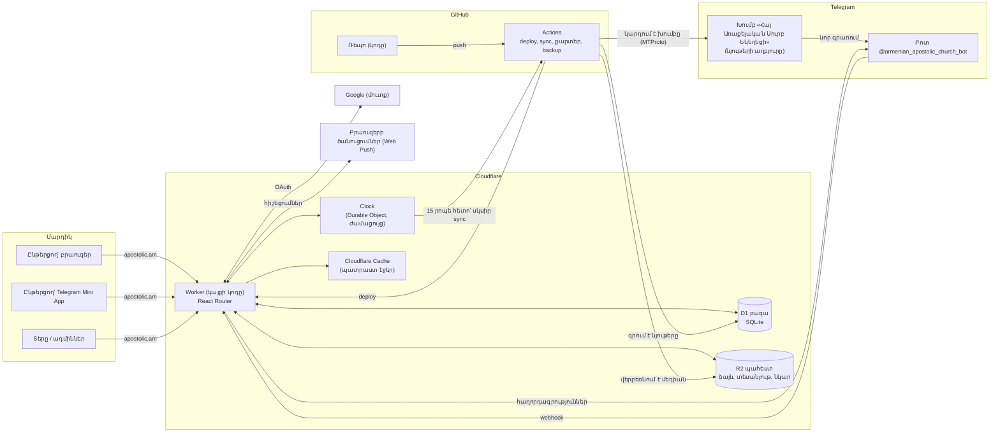

**Սկզբունքը**
- Ընթերցողը երբեք ուղիղ Telegram-ից չի կարդում. ամեն ինչ արդեն կա D1-ում և R2-ում, դրա համար արագ է։
- Worker-ը ամեն հարցման համար աշխատում է Cloudflare-ի մոտակա կետում (Եվրոպա, Երևանին մոտ)։
- Ամեն ինչ անվճար փաթեթի մեջ է. դրա համար շատ տեղ կա խնայողության հնարքներ (բաժին 22)։

## 2. Ինչ տեխնոլոգիաներ են օգտագործված

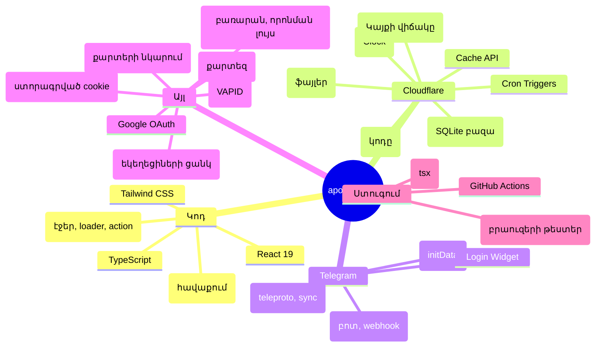

| Ինչ | Ինչի համար |
| --- | --- |
| **React Router v7** | Ամեն էջ՝ `app/routes/*.tsx` ֆայլ. `loader`-ը բերում է տվյալը սերվերում, `action`-ը ընդունում է ձևերը։ Էջը պատրաստվում է սերվերում (SSR), հետո բրաուզերում «կենդանանում» է։ |
| **Cloudflare Worker** | Կայքի ամբողջ սերվերը (`workers/app.ts`)։ Չկա VPS, չկա մշտական սերվեր։ |
| **D1** | SQLite բազա ամպում. նյութեր, մարդիկ, նշումներ, հիշեցումներ, սրբավայրեր… (բաժին 18)։ |
| **R2** | Ֆայլեր. ձայնագրություններ, տեսանյութեր, նկարներ, քարտեր, որոնման ինդեքս (բաժին 19)։ |
| **Durable Object «Clock»** | Միակ «զարթուցիչը». արթնանում է ճիշտ րոպեին (sync, հիշեցումներ, կիրակնօրյա ծանուցում)։ |
| **teleproto (MTProto)** | GitHub Actions-ում կարդում է Telegram խմբի ամբողջ պատմությունը (բոտը դա չի կարող)։ |
| **MapLibre** | Սրբավայրերի քարտեզը։ |
| **satori + resvg** | Ամեն նյութի հղման նախադիտման նկարը (բաժին 17)։ |

### Հեռախոսի հավելվածներ (Android և iPhone)

Տիրոջ որոշումը (2026-11-25). **ամեն ինչ կայքում է, հավելվածը միայն պատյան է։**
- Ամեն գործառույթ նախ արվում է կայքում և աշխատում է բրաուզերում, Telegram Mini App-ում և հավելվածում միանման։
- Հավելվածը (Capacitor, մեկ կոդ երկու հարթակի համար) ավելացնում է միայն այն, ինչ բրաուզերը չի կարող. ֆոնային GPS, հիշեցում/զարթուցիչ փակ հավելվածով, ծանուցումներ iPhone-ում առանց «Ավելացնել էկրանին», վիջեթ։
- Ամեն նման բնիկ գործառույթ արվում է **միաժամանակ Android-ի և iPhone-ի համար**. մեկ հարթակում ունենալ, մյուսում՝ ոչ, չի թույլատրվում։
- Կայքը ստուգում է՝ «հավելվածի մեջ եմ», և միայն այդ դեպքում միացնում է բնիկ մասը. բրաուզերում մնում է սովորական տարբերակը։
- Վիճակը. հավելված դեռ չկա։ Առաջինը Google Play-ն է, հետո App Store-ը (Mac-ը կա)։

## 3. Ինչպես է բացվում մեկ էջ

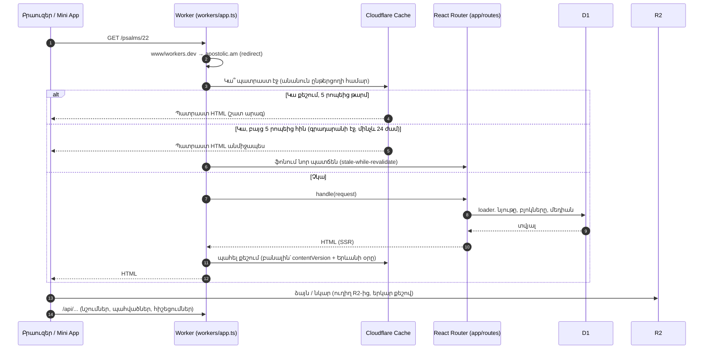

- **Կայքի լուսավորություն (թեմա), տառաչափ, շարժում** (`app/utils/preferences.ts`, `theme.ts`). պահվում են բրաուզերում, էջը բացվում է արդեն ճիշտ գույնով (առանց «թարթման»)։
- **Մոմի ներածություն** (`candle-loader.tsx`). օրը մեկ անգամ այս սարքում (`localStorage` `library-loader-day`, Երևանի օրով, նույն ստուգումը `boot-script.ts`-ում). Telegram-ը Mini App-ի ամեն բացումը նոր session է համարում, դրա համար session-ով չէ։ Մատով սեղմելիս բացվում է 0,4 վրկ-ում։ Մոմի տակ տառ առ տառ ոսկեգույն գրվում է «…Ես ձեզ հետ եմ բոլոր օրերին, / մինչև աշխարհի վախճանը» (Մատթ. 28:20՝ Էջմիածնի Աստվածաշնչից, `VERSE_LINES`), ստորակետից հետո դադար, վերջին տառից 0,5 վրկ հետո լույսը բացում է էջը (ընդհանուր ~6 վրկ)։
- **Edge cache-ը** (`workers/app.ts`, `handle()`). բանալին՝ հասցե + `contentVersion` (նոր/փոփոխված գրառում կամ «Թարմացնել կայքը») + Երևանի օր (էջերը «այսօր»-ով)։ 5 րոպե թարմ է. գրադարանի էջերը (բաժին, նյութ, գլխավոր) 24 ժամ պահվում են և տրվում են անմիջապես, իսկ նոր պատճենը պատրաստվում է ֆոնում։ Սրբավայրերը, որոնումը և մյուսները՝ միայն 5 րոպե։ Cookie ունեցող (մուտք գործած) ընթերցողի **առաջին բացման HTML-ը** cache չունի (root-ում անձնականն է). Worker-ը աշխատում է բազային մոտ (`placement: smart`, `wrangler.jsonc`)։
- **Մուտք գործածների (Mini App) նավարկումը** (`app/utils/personal-data.ts`). կայքի ներսում բեռնվող էջի տվյալները (`<էջ>.data`, route-եր՝ `PUBLIC_DATA_ROUTES` `workers/app.ts`-ում. գլխավոր, բաժին, նյութ, համար) loader-ները **cookie չեն կարդում** (`isPageDataRequest`), ուստի բոլորի համար նույնն են և տրվում են Cloudflare-ի և հեռախոսի cache-ից։ Անձնականը (պահածներ, կարդացել եմ, նշված համարներ, հարցման ձայն, ադմինի իրավունքներ) բերվում է զուգահեռ՝ `/api/personal?kind=material|category&path=…` (`routes/personal-api.ts`, `private, no-store`), և `clientLoader`-ը միացնում է։ Անանուն ընթերցողը այդ հարցումը չի անում։ `tests/telegram-bridge.test.ts`-ը ստուգում է, որ երկու ընթերցողի և անանունի .data-ն բայթ առ բայթ նույնն է։ Նոր route-ը `PUBLIC_DATA_ROUTES`-ում՝ միայն եթե նրա loader-ը .data-ի համար ընթերցողին չի կարդում։ Ամեն պատասխան ունի `Server-Timing: edge;desc="hit|stale|miss|bypass", app;dur=…`։
- **Ձայնագրությունը** (`material-media.tsx`) չի բեռնվում, մինչև «Լսել» (`preload="none"`), տևողությունը՝ Telegram-ի տվյալից։
- **Նյութի էջը հիշողությունում** (`material.tsx` clientLoader, `"material-page"`). ընդհանուր տվյալը 5 րոպե, նույն էջի revalidate-ը միշտ սերվերից։ Քարտերի և սաղմոսի ցանցի հղումները `prefetch="intent"` են, իսկ նյութի հղմանը մատը դիպչելիս (`pointerdown`, ոլորելիս՝ ոչ) սկսվում է անձնականի հարցումը (`prefetchPersonal`, `root.tsx`)։
- **Ոլորման դիրքը** (`<ScrollRestoration />`, `root.tsx`) հիշվում է պատմության ամեն քայլի համար. մենյուից կամ հղումով բացված էջը միշտ վերևից է, «հետ»-ը վերադարձնում է նույն տեղը։ Առաջ դիրքը հիշվում էր հասցեով, ու մենյուից բացված բաժինը բացվում էր նախորդ անգամվա կեսից (2026-11-25)։
- **Բաժնի էջ վերադառնալիս** (`hooks/use-return-anchor.ts`) էջը ամրացվում է սեղմված հղման վրա (նույն բարձրությամբ), ոչ թե պիքսելային դիրքի. ուշ եկող մասերը այլևս չեն իջեցնում էջը։ Աշխատում է միայն «հետ»-ով կամ նյութի «← բաժին» հղումով (`state: { back: true }`, `PageHeader`)։
- **Մենյու** (`site-nav.tsx`, `.menu-panel`). բացվում և փակվում է կոճակի կետից (`scale(.2)`), փակվելիս (`data-closing`, 320 մվ) մշուշը մնում է։ Բացվելիս (`warmSections`) բաժինների տվյալը (`/<բաժին>.data?_routes=section`, միասին ~40 ԿԲ) և գլխի նկարը (`utils/category-image.ts`) նախապես բերվում են. բրաուզերը դրանք պահում է 30 վրկ, ու սեղմելիս բաժինը բացվում է ~0,1 վրկ-ում (առաջ՝ 0,4–0,9)։ React Router-ի `prefetch`-ը `clientLoader` ունեցող էջերի տվյալը չի բերում, դրա համար՝ ձեռքով։ «Տվյալ խնայել» ռեժիմում՝ ոչ։ Route-ի id-ն (`section`) փոխելիս՝ փոխել նաև այստեղ։
- **Էջերի քեշ հեռախոսում** (`navigation-cache.ts`, `search-state.ts`). հեռախոսը պահում է էջերը, մինչև կայքի «բովանդակության տարբերակը» փոխվի (`/api/content-version`)։

## 4. Նյութերը. Telegram-ից կայք

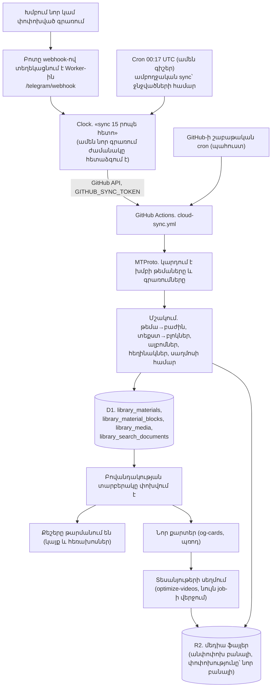

**Telegram-ի «սպասիր» (FLOOD_WAIT)**. մեծ ֆայլ ներբեռնելիս Telegram-ը կարող է ասել «սպասիր N վրկ»։ `streamMedia`-ն
(`gramjs-adapter.ts`, `floodWaitSeconds`) սպասում է և շարունակում նույն բայթից (մինչև 20 անգամ, ≤120 վրկ)։ Եթե մեկ ֆայլ
այնուամենայնիվ չհաջողվի, գրանցվում է `library_sync_failures`-ում, իսկ sync-ը շարունակում է մյուս գրառումները
(wrangler-ի stdin-ի սխալը այլևս պրոցեսը չի գցում)։

**Տեսանյութերի ավտոմատ սեղմում** (`scripts/optimize-videos.ts`, կանոնները՝ `shared/video-optimize.ts`, աղյուսակ՝
`video_optimizations`)։ `cloud-sync.yml`-ի վերջին քայլն է, ուստի աշխատում է ամեն sync-ից հետո (նոր գրառումից 15 րոպե հետո
և ամեն գիշեր)։ Գտնում է դեռ չսեղմված տեսանյութերը՝ Telegram-ից (`library_media`, kind='video'), կայքում ավելացված
(`material_attachments`), սրբավայրերի (`places.video_url`) և օգնության (`site_settings.help_videos`)։ Ամեն մեկը
սեղմվում է ffmpeg-ով **MP4 / H.264 High 4.0 / AAC** ձևաչափով (նվագարկվում է հին և նոր բոլոր հեռախոսներում և
նոութբուքերում). **Կանոններ v2** (2026-11-08, տիրոջ որոշում՝ առավելագույն սեղմում առանց որակը փչացնելու). CRF 30,
կարճ կողմը ≤720, ≤30 կադր/վրկ, ձայնը՝ մոնո 40k (եթե ալիքները նույնն են) կամ ստերեո 64k, `faststart`։ Փորձարկված է
կայքի տեսանյութերի վրա. v1-ի (CRF 26, 64k/96k) համեմատ −40%, SSIM 0.98, աչքով տարբերություն չկա։ HEVC/AV1 չենք
օգտագործում. ոչ բոլոր հեռախոսներում և Telegram-ի ներսում են նվագարկվում։ Փոխարինվում է միայն եթե ≥15%-ով փոքր է (կամ եթե բնօրինակը ոչ բոլոր սարքերում է նվագարկվում՝ HEVC, WebM)։
- Telegram-ի և կայքի ֆայլերը՝ **նույն բանալիով** (այդպես sync-ը դրանք նորից չի բերում). D1-ում թարմանում են
  `size_bytes`, `mime_type`, `r2_etag` (`?v=`-ը փոխվում է, քեշը հինը չի տալիս)։ Sync-ը գրառումը վերագրելիս այս
  երեքը վերցնում է `video_optimizations`-ից։ Բնօրինակը փոխարինումից առաջ պահվում է `originals/<բանալի>`-ում։
- Սրբավայրի և օգնության ֆայլերը՝ նոր բանալի `…-o2.mp4` (v1-ը՝ `…-o.mp4`), հղումը փոխվում է միայն եթե ադմինը
  միջանկյալ չի փոխել։
- **Բնօրինակը ջնջվում է նույն աշխատանքում** (`VIDEO_BACKUP_DAYS = 0`), հենց որ սեղմվածը ստուգվեց. ճիշտ ձևաչափ,
  նույն տևողություն, ձայնը տեղում, և R2-ում պահված ֆայլը նորից կարդացվում ու համեմատվում է (sha256)։ Telegram-ի
  տեսանյութերի բնօրինակը միշտ մնում է Telegram խմբում։
- **Կանոնները փոխելիս** (`VIDEO_PROFILE`, սյունակ `video_optimizations.profile`, migration 0052) արդեն սեղմվածները
  նորից են սեղմվում **բնօրինակից** (երբեք՝ սեղմվածից), փոխարինվում են միայն եթե ≥3%-ով փոքր են, և միայն դրանից
  հետո է ջնջվում բնօրինակը։ Հին կանոններով «թողնված» (`kept`) ֆայլերը նորից են փորձվում։
- Ձեռքով՝ Actions → Cloud sync → `video_only` (առանց Telegram-ի սինքի), `video_limit` (օր.՝ 1՝ փորձնական),
  `mode: dry-run` (միայն ցանկը)։
- **Ձայնագրությունները** (`shared/audio-optimize.ts`, `AUDIO_PROFILE = "a1"`, նույն աղյուսակում՝ `profile LIKE 'a%'`)
  սեղմվում են նույն աշխատանքում, նույն կարգով (բնօրինակը՝ `originals/`-ում, ստուգում, ջնջում)։ MP3-ը մնում է MP3
  (LAME VBR. ստերեո V4 ~110 kbps, խոսքը՝ մոնո V5), AAC-ը՝ AAC (96k/64k)։ Ներսի նկարն ու պիտակները հանվում են։
  Տեսակը (`mime_type`) չի փոխվում (sync-ը ձայնագրության համար `video/mp4` չի գրում)։ Ձայնային հաղորդագրությունները
  (Opus) և արդեն փոքր ֆայլերը (≤136 kbps ստերեո) չեն սեղմվում։ Սաղմոս 22. 2.5 ՄԲ → 0.8 ՄԲ։

**Տեսանյութը փոքր պատուհանում (PiP) և էջից դուրս գալիս** (`app/utils/video-dock.ts`, `material-media.tsx`)։
- Առանձին PiP կոճակ չկա. PiP-ը նվագարկիչի ներսում է (բրաուզերի կոճակները՝ Chrome-ում ⋮ մենյուում,
  Safari-ում՝ պատկերակով)։ Chrome-ը ինքն էլ է բացում PiP-ը ներդիրը/ծրագիրը
  փոխելիս (`mediaSession` → `enterpictureinpicture`, `autopictureinpicture`)։
- Եթե տեսանյութը նվագում է, և մարդը գնում է կայքի մեկ այլ էջ, նույն `<video>`-ը (առանց կանգնելու,
  `moveBefore`, որտեղ կա) տեղափոխվում է ձախ ներքևի անկյուն (`.video-dock`, × փակում է)։ Նույն նյութը
  նորից բացելիս անկյունինը փակվում է, իսկ էջի նվագարկիչը շարունակում է նույն տեղից. մեկ այլ տեսանյութի
  էջ բացելիս անկյունինը պարզապես փակվում է (`takeDockedVideo`)։ Այլ ձայն միացնելիս
  անկյունինը կանգնում է։ Եթե տեսանյութը բրաուզերի PiP-ում է, անկյան պատուհանը թաքնված է (`[data-pip]`),
  որ երկու պատուհան չլինի. PiP-ից դուրս գալիս, եթե դեռ նվագում է, նորից երևում է, կանգնածը՝ փակվում։
- Անկյան պատուհանում բրաուզերի կոճակների փոխարեն մերն են՝ 10 վրկ հետ, նվագել/կանգնեցնել, 10 վրկ առաջ,
  առաջընթացի գիծ (`dockControls`), ↖↘ (բացել էջը), ×։ Կոճակները երևում են սեղմելիս/քաշելիս (`data-ui`) և
  3 վրկ հետո թաքնվում են։ Մեկ մատով քաշելը տեղաշարժում է, ցանկացած անկյունից (30px) քաշելը կամ երկու մատով
  բացելը՝ փոխում չափը (տեղը/չափը հիշվում են՝ localStorage `video-dock-layout`)։ Առաջին սեղմումը ցույց է
  տալիս կոճակները, երկրորդը (կամ ↖↘)՝ բացում տեսանյութի էջը (`library:navigate` իրադարձություն → `root.tsx`-ի `navigate`)։ Ամեն նոր էջում `markDockedCard()`-ը
  նվագող տեսանյութի քարտը (`main a[href=էջ]`-ի `li`) նշում է `data-video-playing`-ով («▶ Հիմա նվագում է»)
  և, եթե այն էկրանից դուրս է, ոլորում է դրան։
- **Բրաուզերից դուրս գալիս ձայնը չի կանգնում** (`app/utils/background-playback.ts`, տեղադրվում է `root.tsx`-ում)։
  Հեռախոսում (Android, iPhone) տեսանյութը միանալիս նախօրոք պատրաստվում է նույն հասցեով էջից անջատված
  `<audio>`։ Էջը թաքնվելիս ձայնը անմիջապես միանում է տեսանյութի տեղից, և միայն դրանից հետո տեսանյութը
  կանգնում է (մի պահ միասին, դադար չկա). վերադառնալիս՝ հակառակը։ iPhone-ում Safari-ն ֆոնում թույլ է տալիս
  միայն մարդու սեղմումով «բացված» էլեմենտ. ցանկացած `touchend`/`click`-ին `play()`+`pause()` (ձայն չի լսվում)։
  Ձայնագրությունը (սաղմոս), եթե բրաուզերը թաքնվելուց 2 վրկ-ում կանգնեցրեց, նորից միանում է։ Համակարգչում
  ոչինչ չի փոխվում, եթե բրաուզերը ինքը չի կանգնեցնում։ Media Session՝ անուն, og:image, ▶/❚❚, 10 վրկ հետ/առաջ.
  ծանուցումից «կանգ»-ը հարգվում է։ Telegram Mini App-ում Telegram-ը ինքն է կանգնեցնում։
- **Ձայնագրությունը էջից դուրս գալիս** (`app/utils/audio-dock.ts`, `components/audio-dock-bar.tsx`). նվագող `<audio>`-ը
  (նույն էլեմենտը) տեղափոխվում է `.audio-dock-host`, իսկ ներքևում, մենյուի կոճակից ձախ, երևում է գոտին՝
  «Լսում եք», անուն (սաղմոսը՝ «Սաղմոս N», սեղմելով՝ էջը), 15 վրկ հետ, կանգնեցնել, փակել, առաջընթացի գիծ։
  Նույն նյութը բացելիս գոտին փակվում է, և էջի նվագարկիչը շարունակում է նույն տեղից։ Այլ ձայն միացնելիս գոտին փակվում է։
  Ցանկում քարտը և գլխավոր էջում բաժինը նշվում են «Լսում եք» (`data-audio-playing`, `markPlayingCards`),
  տեսանյութինը՝ «▶ Դիտում եք» (`data-video-playing`)։ Սաղմոսի տող առ տող ընդգծումը անտեսում է գոտու ձայնը։
- Վերջին դիտած տեղը՝ `app/utils/video-position.ts` (localStorage `video-position:<url>`, ամեն 3 վրկ և կանգնելիս)։
  Էջը նորից բացելիս տեսանյութը սկսում է այդտեղից (առանց ինքնաբերաբար միանալու). վերջին 15 վրկ-ում ջնջվում է։
- Ամեն քայլ գրանցվում է (`pending` → `optimized` / `kept`), ընդհատվածը շարունակվում է, ոչինչ երկու անգամ չի սեղմվում։
  Մեկ աշխատանքի ժամանակը՝ `video_minutes` (լռելյայն 40 րոպե), մնացածը՝ հաջորդ անգամ։ ffmpeg-ը տեղադրվում է միայն
  երբ նոր տեսանյութ կա։ Արդյունքը՝ Կառավարում → Կայքի վիճակը → «Ինչով է լցված պահեստը»։

**Բաժիններ** (Telegram-ի թեմաներ → կայքի բաժիններ, `material-path.ts`). Սաղմոսներ (`/psalms`), Աղոթքներ (`/pray`),
Սրբերի վարք (`/saints`), Ավետարանի ուսուցում (`/gospel`), Օրվա ընթերցումներ (`/daily`), Հարցեր Աստվածաշնչից (`/questions`),
գրառումներ (`/post`)։ Հին հասցեները (`/pray_364`) 301-ով տանում են նորերին։
Ավետարանի ուսուցումը բեռնվում է ամբողջությամբ (մինչև 200, ինչպես աղոթքները) և բաժանվում է թաբերի՝ ըստ հոգևորականի.
անունը տեսանյութի տակի վերջին **շեղ** տողն է (`clergyByline()`, `material-title.ts` → `MaterialCardPreview.clergy`)։ Որոնման արդյունքում (կայքի և բաժնի
որոնում) քարտի վերնագրի տակ շեղ գրվում է հոգևորականի անունը։
Թաբերը երևում են միայն երբ ≥2 հոգևորական կա. անուն չունեցողները՝ «Այլ տեսանյութեր»։ Նոր հոգևորական ավելացնելու համար
կոդ պետք չէ՝ բավական է Telegram-ում նրա անունը գրել վերջին տողում շեղ։

**Ժամերը տեքստում** (`telegram-content.tsx`, `TimestampText`). «01:09»-ի նման ժամը տեսանյութ/ձայն ունեցող էջում
սեղմելի է և տանում է այդ պահին։ Աստվածաշնչի հղումները ժամ չեն համարվում (`utils/verse-reference.ts`). կետով
կրճատ գրքի անունից հետո («Մատթ. 7:13»), միջակայքով («7:13-14») կամ նույն ցանկում ստորակետից հետո («5:3, 6:9»)։
Ստուգվում է ամբողջ պարբերության տեքստով, որ ընդգծված կամ հղում դարձած «7:13»-ն էլ ճանաչվի։

**Նյութի էջը** (`material.tsx`). տեքստ (`rich-text`, `telegram-content`), մեդիա (`material-media`), սաղմոսի տող առ տող
ընթերցում ձայնի հետ (`psalm-read-along`, `psalm_timings`), նախորդ/հաջորդ սաղմոս, կիսվել, պահել, «Կարդացել եմ»,
հիշեցում, բառարանի բառեր, հարցման քվեարկություն։ Կայքում ավելացված ձայնագրություններ (`material_attachments`),
երբ Telegram-ը չի կարող (երկար տեքստ)։
Սաղմոսից սաղմոս անցնելիս (`isPsalmPagePath`) էջի կմախքը (`navigation-progress.tsx` → `PageSkeleton`) չի ցուցադրվում. էջը մնում է տեղում, `article`-ը բեռնման ընթացքում թեթև մարում է, հետո փոխվում է միայն բովանդակությունը։

**Էջերի կմախքները** (`page-skeleton.tsx`, բեռնվում է առանձին ֆայլով `navigation-progress.tsx`-ից). եթե էջը 160 մվ-ից
երկար է բացվում, ցույց է տրվում նրա կմախքը (0,09 վրկ-ում, որ հին և նոր էջերը իրար վրա չերևան)՝ իրական էջի նույն կառուցվածքով. բաժնի գլուխը (նկար, անուն, որոնման կլոր կոճակ),
կայքի համար գրված ներածությունները (`SECTION_INTROS`, `category-cards.tsx`), գլխավոր էջի վերնագիրը (`home-title.tsx`) և
օրվա համարը նկարվում են նույն բաղադրիչներով, ինչ էջում, իսկ բաժնի անունը, սաղմոսի ու համարի թիվը գրվում են իսկական տեքստով։
Ամեն բաժին (սաղմոսներ, աղոթքներ, սրբեր, ավետարան, օրվա ընթերցումներ, հարցեր), նյութի էջ, որոնում, «Իմ անկյունը»
(մուտք գործածի/չգործածի համար տարբեր), սրբավայրեր, օգնություն ունի իր կմախքը։ Էջի տեսքը փոխելիս՝ թարմացնել նաև կմախքը։
Կմախքի վերնագիրը ենթարկվում է «Վերնագրի չափ» կարգավորմանը (`.page-skeleton h1`, `.page-skeleton-title`, `app.css`), այլապես
վերնագիրը նախ մեծ էր, հետո փոքրանում էր։ «Հետ» գնալիս (popstate) կմախք չկա. էջը վերադառնում է իր դիրքին, իսկ կմախքը միշտ վերևն է։

**Աղոթքների ձևավորում** (`prayer-layout-editor.tsx`, `prayer-layout-view.tsx`, `utils/prayer-layout.ts`). աղոթքի էջում
«Ձևավորել» կոճակը (միայն գլխավոր ադմին կամ `layout` իրավունքով) բացում է խմբագիր. ամեն պարբերության տեսակ
(տեքստ / նկարագրություն / պիտակ), դիրք, չափ, տառատեսակ (գրքային / սերիֆ / սովորական), թռչնատառ, ամբողջը թավ/շեղ,
«Աղոթք» նշան (բուն աղոթքի պարբերությունները՝ ընթերցողին չի երևում, հետագա «կիսվել աղոթքը նկարով»-ի համար,
`prayerParagraphs()`). ընտրված բառերին/տառերին՝ թավ, շեղ, ոսկեգույն, կարմիր, չափ, տառատեսակ. տեքստի ուղղում, պարբերությունների բաժանում/միացում/տեղափոխում, հետարկում։ Պահվում է
`material_layouts`-ում (migration 0050, `/api/material-layout`)՝ Telegram-ի տեքստից առանձին, սինքը չի ջնջում։
Ձևավորում ունեցող աղոթքը էջում ցույց է տրվում այդ ձևով (`.reading-body`-ի մեջ, այնպես որ նշումները և բառարանը
աշխատում են), մեդիան՝ վերևում։ `source_hash`-ը Telegram-ի տեքստի նշանն է (`sourceHash`). եթե Telegram-ում տեքստը
փոխվի, ադմինը էջում և խմբագրում զգուշացում է տեսնում և կարող է սկսել նոր տեքստից։ Պահելը/ջնջելը բարձրացնում է
քեշի epoch-ը, որ էջը բոլորի մոտ թարմանա։ Ձայնագրություն ունեցող ձևավորված աղոթքում տող առ տող ընդգծումը չկա։ Ձևավորման տարբերակը՝ `v: 2` (v1-ի
նկարագրությունները բեռնելիս դառնում են շեղ, «Աղոթք»-ը՝ ըստ տեսակի)։

## 5. Էջերի քարտեզը

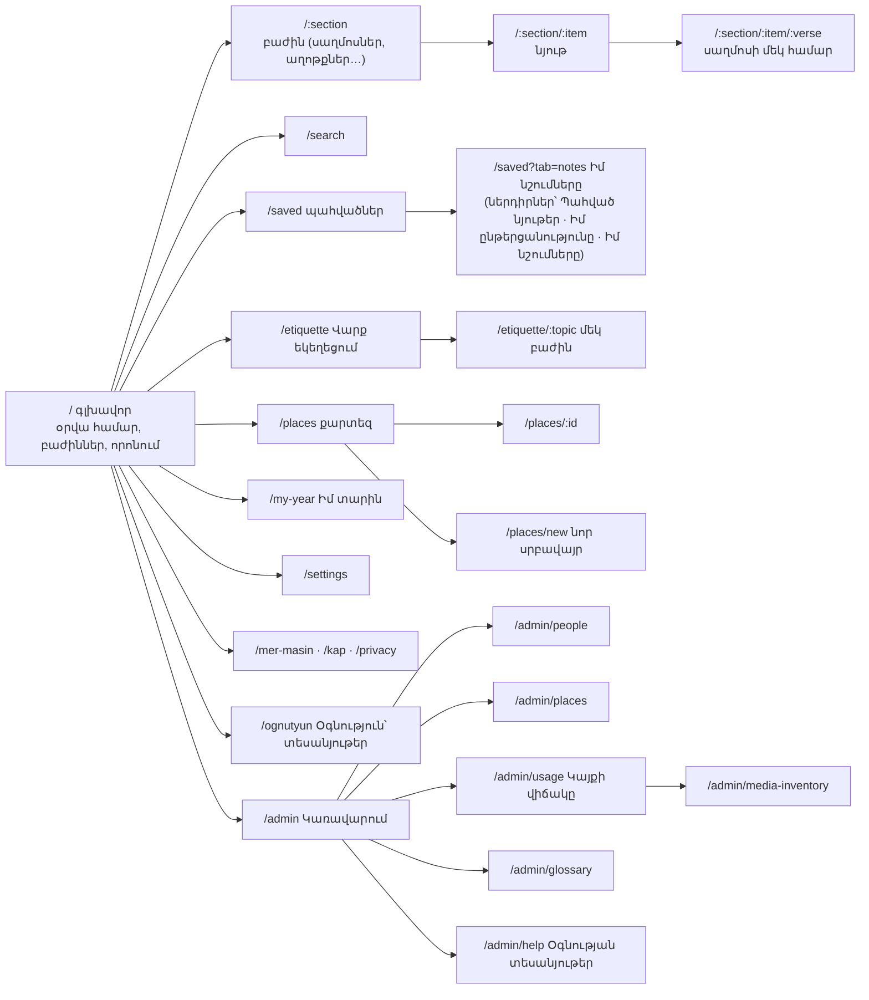

**Վարք եկեղեցում** (`/etiquette`, `/etiquette/:topic`). տեքստերը կոդում են՝ `app/data/etiquette.ts` (բաժիններ, ամեն կանոն՝ «Կանոն / Ավանդույթ / Սնահավատություն», «Ինչ անել», «Ինչու», `POPULAR_QUESTIONS`), ոչ թե բազայում։ `status: "soon"` բաժինը ցուցակում «Շուտով կավելանան» խմբում է և էջ չունի (404), `review`-ը նշվում է «⚑ Ստուգվում է»։ Տեսքը՝ բաց, խմբավորված ցուցակներ (`card`, `groupTitle`, `TopicIcon`՝ `components/etiquette-ui.tsx`)։ Որոնումը՝ `searchEtiquette()` (`app/utils/etiquette-search.ts`, նույն `parseTelegramSearchQuery`/`matchSearchableText`-ով, ինչ կայքի որոնումը). աշխատում է `/etiquette?q=`-ում, թեմայի էջի որոնման կոճակը տանում է այնտեղ, իսկ `/search`-ը ցույց է տալիս «Վարք եկեղեցում» բլոկ (`EtiquetteMatches`)։ Բաժինը կա մենյուում, գլխավոր էջում (`SiteSectionCard`) և sitemap-ում։ Նոր բաժին ավելացնելիս՝ միայն `etiquette.ts` (և պատկերակ `TOPIC_ICONS`-ում)։ Հետո տեքստերը կտեղափոխվեն բազա՝ ադմինի խմբագրով։

**API-ներ** (բրաուզերը կանչում է ֆոնում).
`/api/search-page`, `/api/search-suggestions`, `/api/search-index`, `/api/content-version`, `/api/reading-log`,
`/api/reminders`, `/api/calendar`, `/api/push`, `/api/saved-verses`, `/api/poll-vote`, `/api/psalm-timings`, `/api/material-layout`,
`/api/presence`, `/api/highlights`, `/api/church-points`, `/api/place-visits`, `/api/places-search`, `/api/glossary`, `/api/sunday`, `/api/my-summary`,
`/api/telegram-link`, `/api/og-cards`, `/api/categories/:slug/posts`, `/api/help-videos`։
**Ֆայլեր**. `/media/...` (R2-ի պահուստային ճանապարհ), `/place-media/...`, `/help-media/...`, `/og/card/...`, `/sitemap.xml`։

**Որոնիչների համար (SEO)**. Ամեն էջի վերնագիրը, նկարագրությունը և structured data-ն տալիս է `seoMeta()`-ն (`app/utils/seo.ts`). վերնագիրը մինչև 65 նիշ է (`pageTitle()`), սեփական structured data չունեցող էջը ստանում է «Գլխավոր → էջ» ճանապարհը։ Սրբավայրի էջը մտնում է որոնման և sitemap-ի մեջ միայն երբ բովանդակություն ունի (`placeHasContent()`՝ պատմություն ≥ 80 նիշ, նկար, արարողություններ կամ ծառայողներ). դատարկները `noindex, follow` են, լրացվելուն պես ինքնուրույն բացվում են։ `/places`-ում և «ավելին»-ով բեռնվող բաժիններում (`/daily`, `/gospel`) բոլոր էջերի հղումները HTML-ում են՝ օգտատիրոջը հասանելի `<details>` ցանկերով։ Մոմի ներածությունը ցուցադրվում է միայն երբ այցը սկսվում է գլխավոր էջից (`root.tsx`)։ Սրբավայրի նկարը էջում՝ `?w=1200` (WebP, R2-ում պահվող), նախադիտման մեջ՝ `?w=1200&f=jpg` (JPEG)։ `/places`-ում ամեն մարզ մեկ բացվող քարտ է (`<details>`). փակ վիճակում ներսում պարզ հղումներ են, բացելիս՝ նկարներով ցանկը։ Սրբավայրի նկարների չափերը պահվում են `place_photo_sizes`-ում (migration 0053, լրացվում է ինքնուրույն՝ `placePhotoSizes()`), որ նկարի տեղը նախապես պահվի և էջը չցատկի։ Բոլոր պատկերակները (lucide) build-ում մեկ `icons` ֆայլում են (`vite.config.ts`)՝ էջը տասնյակ JS հարցում պակաս է անում։

Sitemap-ը բաց է թողնում բաժնի ներածական գրառումները՝ նույն կանոնով, ինչ որոնման ինդեքսը (`INTRO_TOPICS`, առաջին տեքստային նյութ՝ առանց պատրաստ մեդիայի)։ Դրանց հին էջերը պահպանվում են։ Սաղմոսի համարի էջը (`/psalms/47/3`) պահպանում է իր UI-ը, կիսվելու `og:url`-ն ու նկարը, իսկ `canonicalPath`-ը ցույց է տալիս ամբողջ սաղմոսը (`/psalms/47`)։ Canonical հասցեները production դոմենով են, staging-ը շարունակում է ունենալ `X-Robots-Tag: noindex`։ Սաղմոսի որոնման վերնագրում միշտ նշվում է համարը (`materialSeoTitle`)։ Հանրային sitemap-ի ամբողջական ստուգում՝ `node scripts/seo-audit.mjs https://apostolic.am`․ երկու զուգահեռ հարցում, HTTP/canonical/noindex/title/description/H1 ստուգումներ։ Սա Google-ի ինդեքսավորման երաշխիք կամ Search Console-ի տվյալների փոխարինում չէ։

## 6. Մուտք և հաշիվներ

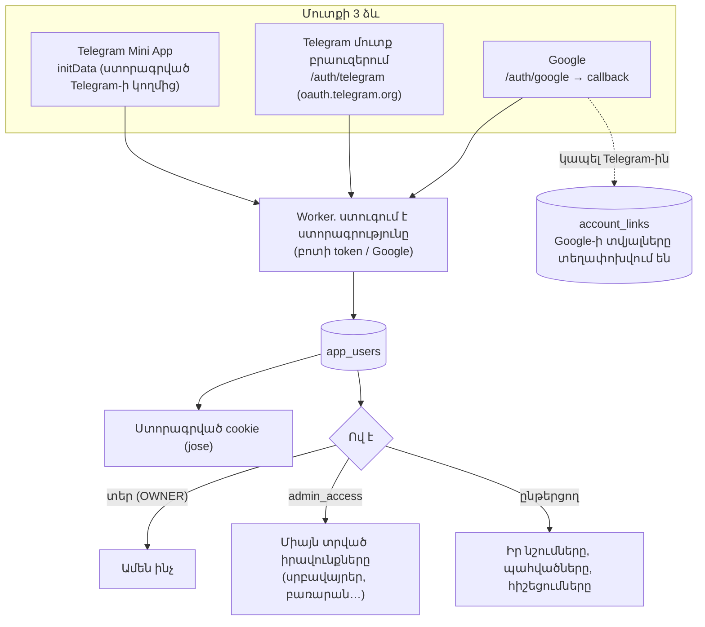

- Մուտք չգործած ընթերցողը կարդում է ամեն ինչ. մուտքը պետք է միայն անձնական բաների համար։
- **Այցերի վիճակագրությունը անանուն է** (`site_presence`). հաշվի հետ չի կապվում։

### Անձնական չատ (`/namak`)

> **Հիմա փակ է** (տիրոջ որոշում, 2026-11-15)՝ `PRIVATE_CHAT_OPEN = false` (`app/utils/private-chat.ts`). `/namak`-ը, ֆայլերը, ֆոնը և «chat» socket-ը՝ 404, ✉ կոճակը մենյուում չի երևում։ Աշխատում է միայն `?where=app` socket-ը, որ տերը ստանա «🟢 Նա հիմա կայքում է» ծանուցումը (բացում է `/`)։ Տվյալները (DO) մնում են. նորից բացելու համար՝ `true`։

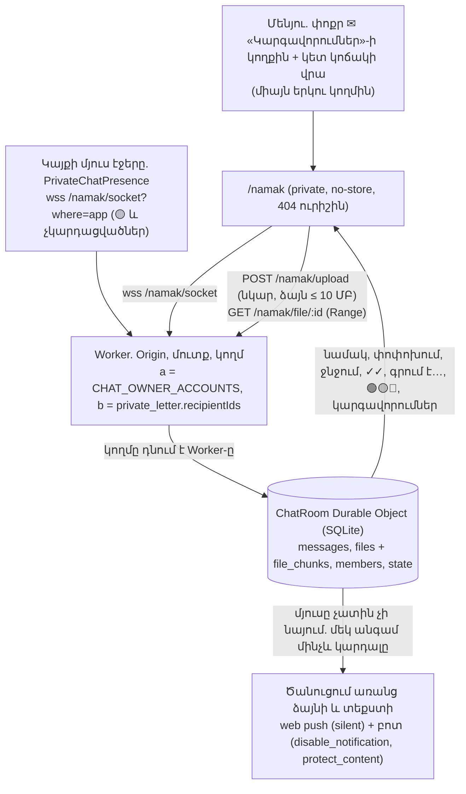

- Մտնում են միայն երկու կողմ. «a»՝ միայն `CHAT_OWNER_ACCOUNTS`-ի (production, `wrangler.jsonc`. չկա՝ `OWNER_ACCOUNTS`) հաշիվները կամ դրանց կապված հաշիվները (`isOwnerIdentity`), ոչ թե «գլխավոր ադմին» դարձված մյուսները. «b»՝ ստացողը (նույնպես կապված հաշիվներով)։ Մնացած բոլորին էջը, socket-ը և ֆայլերը 404 են։
- Ամեն ինչ (տեքստ, նկար, ձայն) պահվում է **միայն** `ChatRoom` DO-ի SQLite-ում (`workers/chat-room.ts`, ֆայլերը՝ 1 ՄԲ կտորներով), ոչ թե D1-ում կամ R2-ում (R2-ն ունի հանրային media հասցե). ուստի չկան backup-ում, ադմինի էջերում։ Ֆայլերը՝ `private, no-store`, `sandbox` CSP, միայն JPEG/PNG/WebP/GIF և webm/ogg/mp4/mpeg/aac (SVG՝ ոչ)։ Ջնջելիս տեքստը/ֆայլը իսկապես ջնջվում է. «Ջնջել ամբողջ զրույցը»՝ միայն տերը (մնում են կարգավորումները)։
- Լույս. 🟢 չատում է (էջը էկրանին), 🟡 կայքի այլ էջում է (էկրանին), 🔴 փակ է + «վերջին անգամ»։ Երբ «b»-ն փակից գալիս է կայք (≥ 3 րոպե բացակայությունից հետո), տիրոջը գնում է լուռ «🟢 Նա հիմա կայքում է» (push + բոտ, ≤ 20 րոպեն մեկ, `shouldNotifyPresence`), եթե տերը հիմա չատում չէ. նախորդ բոտի ծանուցումը ջնջվում է։ Անջատվում է տիրոջ կարգավորումներում (`presence_notify_a`)։ Առաջին մուտքը (վիճակ դեռ չկա) նույնպես ծանուցում է։
- Տիրոջ ⚙-ում «Ստուգում» (`chatDiagnostics`). ստացողի հաշիվները (Google/Telegram), մտե՞լ է արդյոք և երբ, ծանուցումների ուղիները երկու կողմի համար (Telegram բոտ, բրաուզերի push)։ Նամակների տեքստ չկա։ Ամեն socket-ին կցված է `where` և `visible` (`statusOf`)։
- Ամեն կողմի կարգավորումը (DO `state`). ինչ անունով է տեսնում մյուսին (`nick_<side>`), տեքստի չափը (`font_<side>`), ֆոնը (`bg_<side>`՝ իր նկարը DO-ում, չկա՝ ընդհանուրը) և ֆոնի թափանցիկությունը (`bgop_<side>`)։ Ընդհանուր ֆոնը կոդում է (`app/data/private-chat-background.server.ts`, ռեպոն փակ է), տրվում է `GET /namak/background`-ով միայն կողմերին, ոչ թե `public/`-ից։ Ֆայլերը՝ `Cross-Origin-Resource-Policy: same-origin`։ Նամակը՝ մինչև 50 000 նշան, փոփոխելի (միայն տեքստը, «փոփոխված»)։ Պատասխան (reply)՝ ցանկացած նամակին (իր կամ մյուսի). `messages.reply_to`, կարդալիս `LEFT JOIN`-ով բերվում է մեջբերման կարճ տեքստը (200 նշան), մեջբերման վրա սեղմելիս՝ գնում է բուն նամակին։
- Ստացողը նշվում է տիրոջ «Կարգավորում»-ում (Gmail կամ @username → անփոփոխ id-ներ)։ Չջնջված նամակներ ունենալուց հետո ստացողին փոխել չի կարելի։ Ամեն պահելիս `resetRecipient`-ը փակում է նախկին ստացողի բաց socket-ները և ջնջում նրա `members`-ը, «վերջին անգամ»-ը և կարգավորումները (նույն ստացողինը՝ ոչ), որ նրան ոչ նամակ, ոչ ծանուցում չհասնի։
- Hibernation. socket-ները բաց են, օբյեկտը քնում է. «ping»-ին պատասխանում է առանց արթնանալու։ Կենդանի է այն socket-ը, որի վերջին «ping»-ը (`getWebSocketAutoResponseTimestamp`) կամ իրադարձությունը 90 վայրկյանից նոր է (`isAlive`)։ Մնացածը (հեռախոսը փակել է էջը առանց կապը փակելու) լույսի մեջ չեն հաշվվում, և `alarm()`-ը (րոպեն մեկ, միայն երբ կապեր կան) փակում է դրանք ու թարմացնում լույսը։ Նախկին ստացողի փակվող socket-ները (`revoked`) «վերջին անգամ» չեն գրանցում։ Չհաստատված տեքստերը նորից են ուղարկվում (`client_id`՝ կրկնություն չկա)։ Ձայնի համար `Permissions-Policy: microphone=(self)`։
- Չատի էջում root-ի պատուհանները (կիրակնօրյա հարց, ուղեցույց, «Ավելացնել էկրանին», եկեղեցու հուշում) չեն բացվում։
- Կոդը՝ `app/routes/private-chat.tsx`, `app/components/private-chat.tsx`, `app/components/chat-socket.ts`, `app/components/private-chat-presence.tsx`, `app/data/private-chat.server.ts`, `app/utils/private-chat.ts`, `workers/chat-room.ts`, `wrangler.jsonc` (`CHAT`, migration `v2`)։

## 7. Որոնում

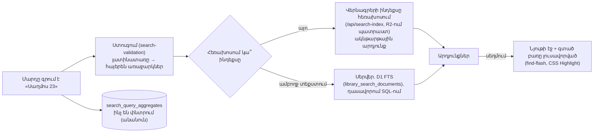

Էջի ներսում որոնում (`page-find.tsx`). բաժնի ցուցակը նեղանում է մուտքագրելիս։

**«Գուցե նկատի ունեիք»** (`shared/search-correction.ts`). լատինատառը դառնում է հայերեն, տառասխալը
ուղղվում է ըստ վերնագրերի բառերի (սերվերում՝ `app/data/search-correction.server.ts`, 10 րոպե
հիշողության մեջ, հեռախոսում՝ վերնագրերի ինդեքսից)։ Լատինատառ կամ ոչինչ չգտած որոնումը բացվում է
ուղղվածով (`/search?q=սաղմոս&asked=Saxmos`), «Փնտրել հենց …»՝ `&exact=1`։ Մնացածում՝ «Գուցե
նկատի ունեիք» և «Նման բառեր» կոճակներ։

**Այլ լեզուներ** (`shared/search-foreign.ts`). անգլերեն, ռուսերեն, ֆրանսերեն, իսպաներեն, գերմաներեն,
իտալերեն, արաբերեն, պարսկերեն բառերը («psalm», «молитва», «prière») դառնում են հայերեն բառը և
բացվում են դրանով (`?q=Սաղմոս&asked=psalm`), սերվերում էլ, հեռախոսում էլ։ Ռուսատառ հայերենը
(«сагмос») դառնում է լատինատառ, հետո՝ «Գուցե նկատի ունեիք»-ով հայերեն։ Նոր բառ՝ `FOREIGN_TERMS`-ում։
Հեռախոսում բաժնի անունով որոնումը («Սաղ», «saxmos») բերում է այդ բաժնի նյութերը՝ վերնագրով
գտածներից հետո։ «Ճշգրիտ համընկնում չգտնվեց»-ը երևում է միայն երբ բոլոր արդյունքները տառասխալով են։

**Բառի տեղը տեքստում** (`foldedMatches`, `shared/telegram-search.ts`). հին և նոր ուղղագրությունը
համեմատվում են (անիրավ = անիրաւ, Տեր = Տէր, թյուն = թիւն)։ Օգտագործվում է արդյունքի հատվածում
(`locateStoredSearchHit`) և բացված էջում բառի ընդգծման համար (`app/utils/find-flash.ts`)։

**Որոնման դաշտը՝ անկյունի կոճակից** (`ExpandingSearch`, `app/components/page-layout.tsx`). ամեն էջի
(բացի գլխավորից) որոնումը բացվում է վերնագրի տողի կլոր կոճակից, էջն իջնելիս կպչում է էկրանի
վերևին, Enter-ից հետո ստեղնաշարը փակվում է։ Բաժնում գտնվածները պայծառ են, մնացածը՝ մեղմ (`[data-finding]`)։

## 8. Կարդացել եմ / Լսել եմ / Օրացույց

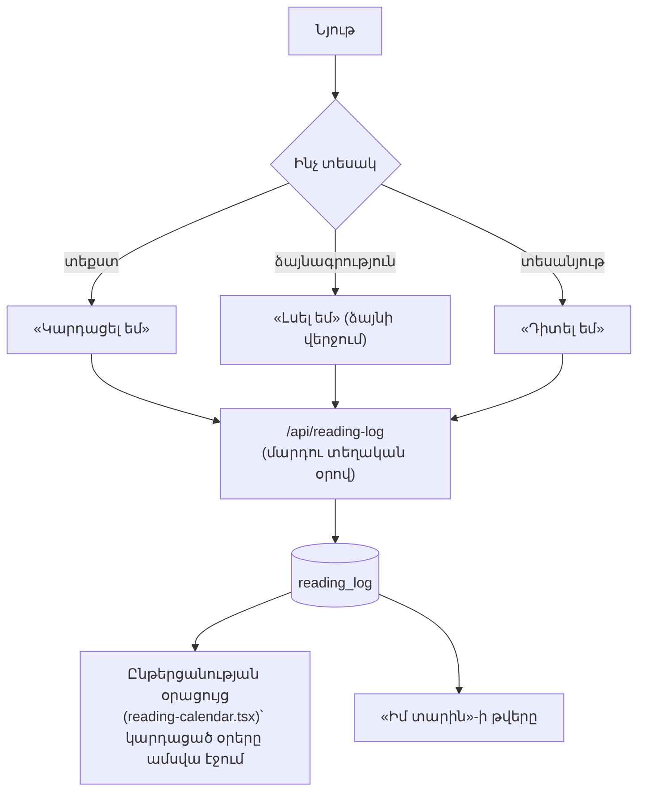

## 9. Հիշեցումներ

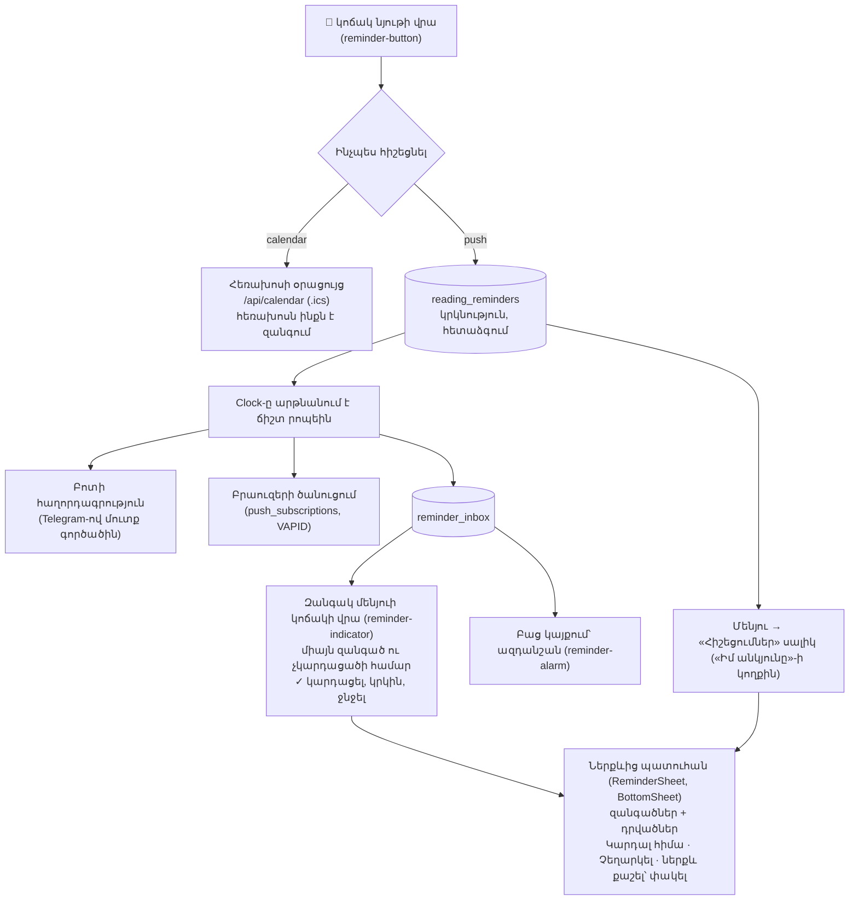

## 10. Կիրակնօրյա հարց և «Իմ տարին»

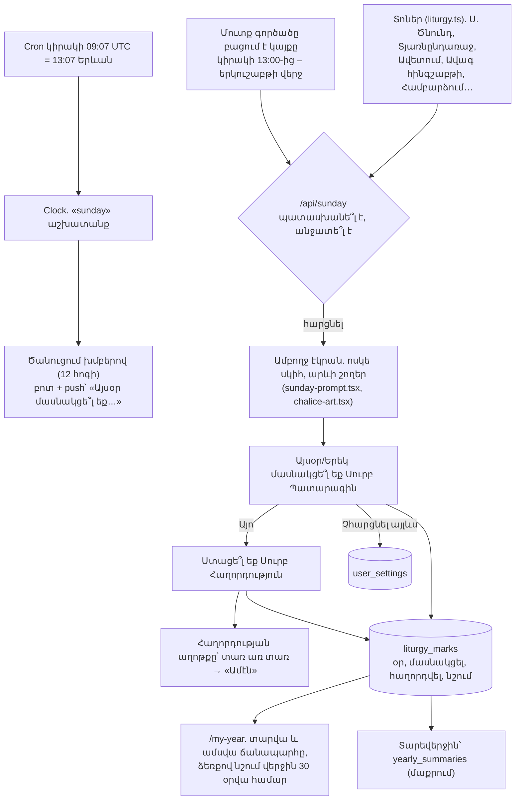

## 11. Սրբավայրեր և քարտեզ

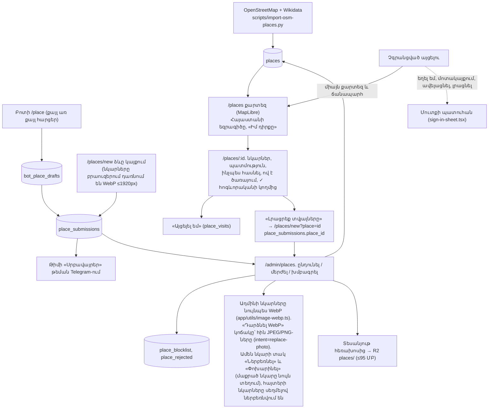

**Ճանապարհը և մուտքը** (`places.accessibility`)՝ 4 հարց, նույնը բոտում և կայքի ձևում (`ACCESS_PARTS`, `app/utils/place-answers.ts`)․
🚗 Մեքենայով հասանելիություն, 🪨 Ճանապարհ, ♿ Թեքահարթակ, 🚪 Մուտք։ Ամեն պատասխան՝ իր տողով («Թեքահարթակ՝ առկա է»),
նշանները ավելացվում են ցուցադրելիս (`readAccess`, `accessText`)։ Հին «Ճանապարհը՝ …», «Մուտքը՝ …» տողերը նույնպես ցույց են տրվում։
- Քարտեզի եզրը (Հայաստանի ուրվագիծ)՝ `clip-path` canvas-ի վրա. canvas-ի տակ թափանցիկ `.places-map-catcher` շերտը MapLibre-ի container-ում է, որ ուրվագծից դուրս քաշելը նույնպես շարժի քարտեզը (`places-map.tsx`)։
- Քարտեզի քարտիկում՝ «Կիսվել» կոճակ (`ShareButton`). կիսվում է `/places/<id>` էջի հղումը։
- Սրբավայրի էջում «Կիսվել»-ը վերևի աջ անկյունում է (`PageHeader`-ի `action`, որոնման ձախ կողմում)։ Հղման նախադիտման նկարը եկեղեցու առաջին լուսանկարն է՝ JPEG (`/place-media/…?w=1200&f=jpg`, R2 `thumbs/…-w1200.jpg`), չափերով (`og:image:width/height`). WhatsApp-ը WebP-ն միշտ ցույց չի տալիս։
- **Ծառայողների դիմելաձևերը** (`app/utils/clergy-titles.ts`)․ բոտում, `/places/new`-ում և ադմինի խմբագրիչում (`ClergyField`) ընտրվում է աստիճանը, գրվում է միայն անուն-ազգանունը, և կայքը ինքն է դնում դիմելաձևը («Սարկավագ» + «Կարեն Առաքելյան» → «Բարեշնորհ Կարեն սրկ. Առաքելյան»)։ Ձեռքով գրված «Դեր՝ Անուն Ազգանուն» տողերը ձևավորվում են պահելիս և ցուցադրելիս (`formatClergy`). արդեն դիմելաձևով անունները և անծանոթ դերերը («Թեմի Առաջնորդ») չեն փոխվում։ ⚑ Դիմելաձևերի ցանկը՝ հոգևորականների ստուգման համար։
- **Ադմինի խմբագրիչի ընտրիչները** (`app/components/place-schedule.tsx`, `app/utils/place-schedule.ts`)․ Սուրբ Պատարագ, Ժամերգություններ, Բաց է՝ օրը մեկ սեղմումով, ժամերը՝ մի քանիսը միանգամից (կամ իր ժամը), «+ Ավելացնել»-ը դաշտում ավելացնում է «Կիրակի 10:00 և 12:00» տողը. «Ճանապարհը և մուտքը»՝ 4 հարցի կոճակները (հին/ազատ տողերը մնում են)։ Դաշտերը մնում են ազատ խմբագրելի։


## 12. Բոտը

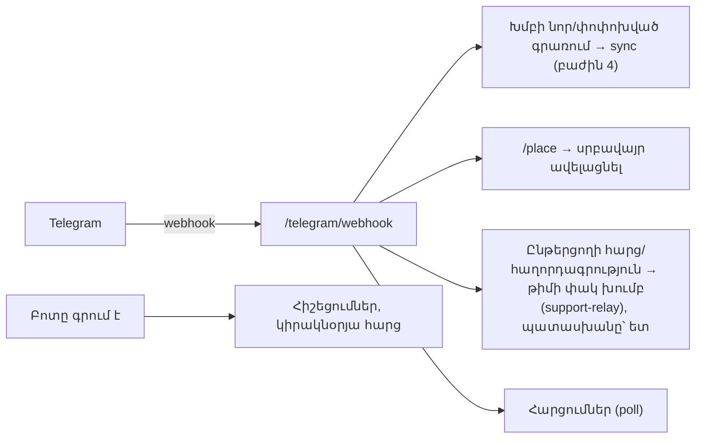

## 13. Բառարան

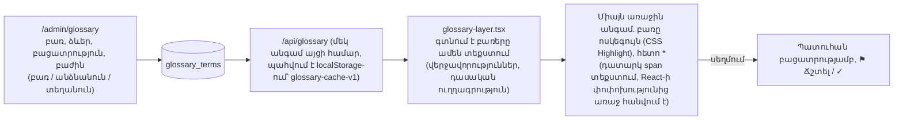

## 14. Պահված նյութեր, համարներ, հարցումներ

| Ինչ | Աղյուսակ | Որտեղ է երևում |
| --- | --- | --- |
| Պահված նյութեր և նշումներ | `saved_materials` | `/saved` |
| Սաղմոսի համարի «Նշել» | `highlights` (`verse` սյունակ). հին `saved_verses`-ը տեղափոխվեց (migration 0048) և այլևս չի գրվում | համարի պատուհան, «Իմ նշումները» |
| Նշումներ տեքստում (պահված խոսք, ❓ հարց, սմայլիկ, նոթ, պատասխան) | `highlights` | ամեն նյութի տեքստում, «Իմ անկյունը» → «Իմ նշումները» |
| Հարցման ձայներ | `poll_votes` | Telegram-ի հարցումները կայքում |
| Սաղմոսի ժամանակացույց (տող↔ձայն) | `psalm_timings` | տող առ տող ընթերցում |
| Օրվա համար | `daily-verses.ts` | գլխավոր էջ |
| Տեղադրել որպես հավելված (PWA) | — | `install-prompt.tsx` |

### Նշումներ տեքստում (highlights)

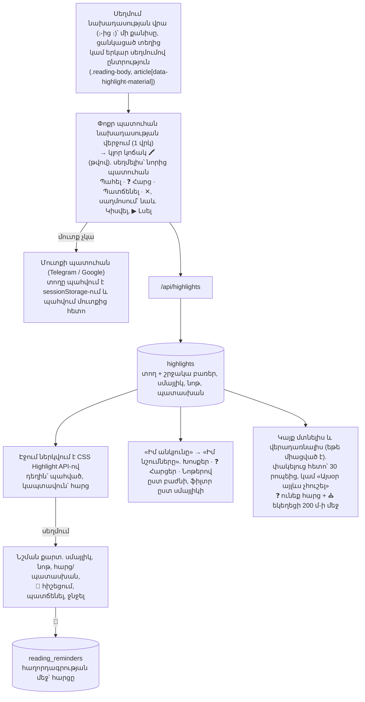

- Մեկ սեղմման դեպքում Android Chrome-ի «Touch to Search» (Google-ի ներքևի պատուհան) չպետք է բացվի. էջը փոխվում է հենց սեղմման պահին (`flushSync`)։ Երկար սեղմումով ընտրության դեպքում վահանակը մնում է նաև ընտրությունը մաքրվելուց հետո։
- Ընտրվածի վրա սեղմելը հանում է այն ըստ էկրանի իրական տեղի (`rangeHit`), ոչ թե կուրսորի հաշվարկով։ Բրաուզերի մնացած ընտրությունը (Touch to Search, երկար սեղմում) այլևս չի արգելափակում սեղմումը. այն հաղթում է միայն մկնիկով քաշելիս կամ կրկնակի սեղմումով։ Վերջակետից անմիջապես աջ սեղմելը՝ այդ նախադասությունն է, ոչ թե հաջորդը (`sentenceAt`)։
- Որոնման էջի «Իմ նշումները» արդյունքներում որոնված բառը նշված է (`matchAround`), երկար տողի սկիզբը կտրվում է, որ բառը երևա։
- Նախադասության սահմանները՝ `sentenceAt`. վերջակետից վերջակետ (`։ : ! ? …`), «.» միջակետը, «՞»-ն և պարզ նոր տողը վերջ չեն, վերնագրերը՝ կոշտ սահման (`\u2029`, `buildTextMap`)։ Սաղմոսի համարը («3 ») տողի մեջ չի մտնում։
- **Համարը առաջնային է** (`verseBoundsAt` + `verseSpan`). եթե սեղմված տողը ունի `data-verse` (սաղմոս, ապագայում՝ Աստվածաշունչ), նշվում է ամբողջ համարը՝ բոլոր իրար կողքի տողերը նույն `data-verse`-ով, առանց համարի թվի։ Միայն ոչ համարակալված տեքստում (աղոթք, վարք, օրվա ընթերցում)՝ նախադասությամբ։ Նոր համարակալված բաժին ավելացնելիս բավական է ամեն տողին դնել `data-verse`։ Կառավարման կոճակներն ու գրությունները `.reading-body`-ի մեջ պետք է ունենան `data-highlight-skip`։
- Նշման քարտում նշումը (և պատասխանը) պահվում է «Պահել» կոճակով։ Սմայլիկը՝ մեկ հատ (`cleanEmoji`, `firstEmoji`)։ Որոնման էջը մուտք գործածի համար ցույց է տալիս նաև «Իմ նշումները» (`/api/highlights?q=`)։
- Պատուհանում «Հարց» չկա (նշումը «Հարցեր» է տեղափոխվում նշման քարտից՝ «Տեղափոխել «Հարցեր»»)։ Մուտք չգործածի համար նախ բացվում է մուտքը, նշելու պատուհանը փակվում է։ Բացվելը/փոքրանալը՝ `highlight-pop` / `highlight-pop-out` անիմացիաներով (transform-origin՝ նախադասության վերջը)։
- Պատուհանը 1 վայրկյան հետո դառնում է կլոր կոճակ (`COLLAPSE_MS`), հաջորդ նշումները այն չեն բացում, միայն կոճակի վրա սեղմելը։ Էջը փոխելիս կամ տեքստից դուրս սեղմելիս ընտրվածը չեղարկվում է։ Նշման քարտում «Ջնջել»-ը միանգամից է, մարդու ավելացրած սմայլիկները (✓/✕) մնում են արագ ցանկում (`localStorage` `my-emojis`)։
- Մի քանի նախադասություն (`toggleSentence`). պահելիս կպածները դառնում են մեկ նշում (`mergeSpans`), մնացածը՝ առանձին։
- Սաղմոսի հին համարի պատուհանը (`VersePopup`) հանված է. «▶ Լսել»-ը ուղարկում է `psalm-listen` իրադարձություն `psalm-read-along.tsx`-ին, «Կիսվել»-ը՝ համարի էջի հղումը։
- «Իմ անկյունը» (`/saved`)՝ 3 ներդիր (`?tab=saved|reading|notes`, վերջինը հիշվում է). `/notes`-ը 301-ով տանում է `/saved?tab=notes`։
- Տողը գտնվում է իր տեքստով և 32 նշան առաջ/հետո (`app/utils/highlights.ts` `findQuote`). նյութը փոխվելիս նշումը մնում է `/notes`-ում։
- Բառարանի կետագիծը և նշման ետնագույնը իրար չեն խանգարում. կարճ սեղմումը բառարանի բառի վրա բացում է բառարանը, և այնտեղ կա «📌 բացել նշումը»։
- Եկեղեցու հուշումը քարտ է վերևում (մնում է, մինչև փակեն, թեթև թրթռոցով). «Դեպի եկեղեցի»-ն բացում է նկարը, անունը, Google Maps / Yandex ճանապարհը։ Դիրքը չի գնում կայք, `/api/church-points`-ից եկեղեցիների ցանկը բեռնվում է, և հեռավորությունը հաշվում է բրաուզերը (`components/church-nudge.tsx`)։ Միացնում է մարդը `/notes`-ի «Հարցեր» ներդիրում։ Տեղորոշումը չստացվելիս ցույց է տրվում `components/location-help.tsx`-ը (նույնը, ինչ «Իմ մոտակայքում»-ում). քայլեր ըստ սարքի (iPhone՝ Safari-ի և «Safari-ի կայքեր»-ի կարգավորումները), Telegram-ում մերժված թույլտվության դեպքում սեղմելիս միանգամից բացվում է Telegram-ի կարգավորումը (`LocationManager.openSettings`)։
- Մեկ մարդուն՝ մինչև 2000 նշում, տողը՝ մինչև 1200 նշան։
- Տեքստում պահված խոսքն ու հարցը նույն մեղմ դեղին գույնն ունեն (`::highlight(user-mark)`, `user-question`). տարբերությունը երևում է միայն քարտում։ Եկեղեցու հուշման շառավիղը 200 մ է, դիրքը վերցվում է ճշգրիտ (`findMyPosition({ precise: true })`՝ GPS, 30 վայրկյանից ոչ հին)։

### «Որտեղ էիք կանգնել» (վերջին կարդացածը/լսածը)

- `components/continue-reading.tsx`. `PlaceTracker` (root-ում, **միայն մուտք գործածների համար**) նյութի էջում 8 վայրկյանից կամ ձայնը/տեսանյութը միացնելուց հետո հիշում է բաժինը, հասցեն, անունը, «կարդացել/լսել/դիտել», որքան էր թերթել և տեսանյութի վայրկյանը (`utils/last-place.ts`, `localStorage` `last-places`, այս սարքում, 60 օր)։
- `ContinueCard`՝ միայն բաժնի էջում (գլխավոր էջում՝ ոչ)։ Քարտի մարմինը՝ ցանկում իջնում է մինչև այդ նյութը և վառում այն (տեսանյութի դեպքում՝ բացում է էջը, տեսանյութը պատրաստ է նույն րոպեից), սլաքը՝ բացում է նյութը նույն տեղից (տեսանյութը՝ միանգամից շարունակվում է)։
- Ելքի ժամանակ (և երբ մարդն այլևս մուտք գործած չէ) անձնական տվյալները մաքրվում են սարքից՝ `utils/personal-storage.ts` (`clearPersonalStorage`)։ Service worker-ը անձնական API-ները (`/api/highlights` և այլն) չի պահում։
- Չեն հիշվում՝ «Օրվա ընթերցումներ» (`daily`) և սրբավայրեր։ Բաժինը հասցեի առաջին մասն է, ուստի ապագա Աստվածաշունչը կաշխատի նույն ձևով։

## 15. Կառավարում (ադմին)

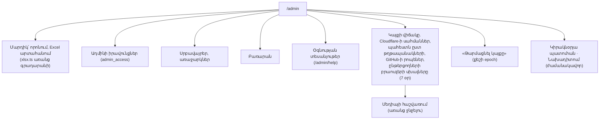

### Օգնություն (ուսուցողական տեսանյութեր)

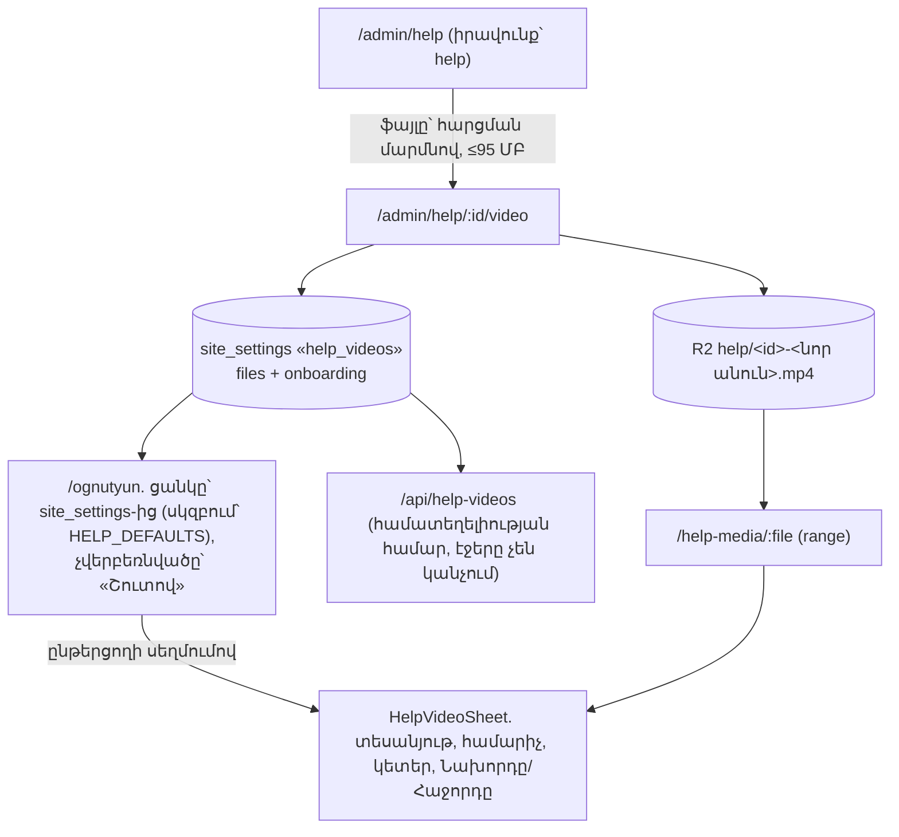

- Ցանկը (վերնագրեր, կարգ) ադմինն է խմբագրում `/admin/help`-ում՝ ավելացնել, անվանել, ↑↓, «Հանել ցանկից» (տեսանյութն էլ է ջնջվում)։ Պահվում է `site_settings.help_videos.items`-ում. մինչ առաջին խմբագրումը՝ `HELP_DEFAULTS` (`app/utils/help-videos.ts`)։ Նոր տարրի id-ն՝ `v-…`։
- Նոր ֆայլը ստանում է նոր անուն, նախորդը R2-ից ջնջվում է (`setHelpVideo`), ուստի `/help-media/`-ը քեշվում է անվերջ։
- Օգնությունը ավտոմատ չի բացվում. տեսանյութը բեռնվում է միայն «Օգնություն» էջում ընթերցողի ընտրությունից հետո։ Պատուհանը պահում է ստեղնաշարի focus-ը ներսում, Escape-ով փակվում և focus-ը վերադարձնում բացող կոճակին։
- Տեսանյութերը պատրաստվում են `scripts/video-guides/`-ով (README)։

## 16. Ժամացույց (Clock) և cron-ներ

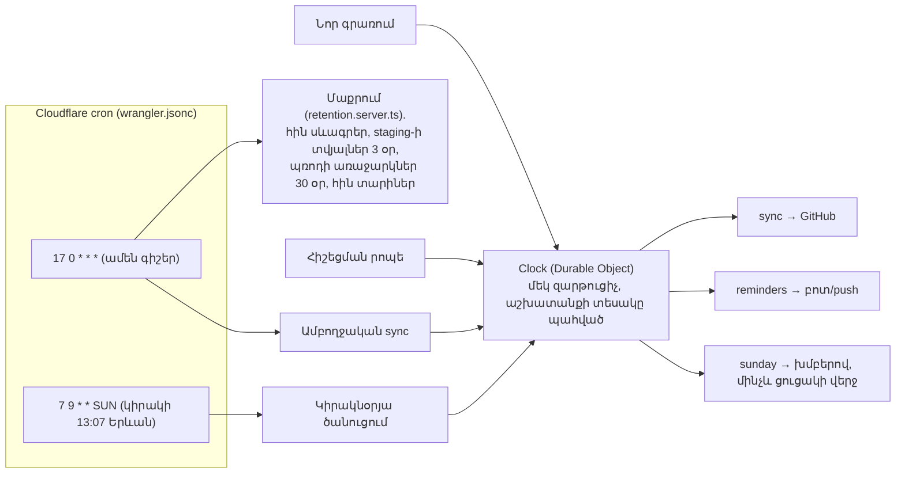

Ոչինչ չի աշխատում «ամեն րոպե». Clock-ը արթնանում է միայն այն պահին, երբ գործ կա (անվճար սահմանը օրական 100 000 հարցում է)։

## 17. Հղումների նախադիտման քարտեր

Երբ նյութի հղումն ուղարկում ես Telegram-ով, WhatsApp-ով, Facebook-ով, հղման տակ երևում է **նկար-քարտ**
(վերնագիր, տեքստի կտոր, խորհրդանիշ)։ Դա «Link-preview card» (Open Graph նկար) է։

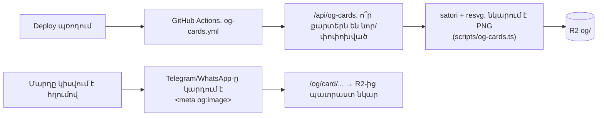

Նկարվում է GitHub-ում, որովհետև մեկ քարտը ~1 վայրկյան CPU է ուզում, իսկ անվճար Worker-ին թույլատրված է շատ ավելի քիչ։
Նկարվում են միայն նոր կամ փոփոխված քարտերը։ 2026-11-02-ից՝ միայն պռոդի deploy-ից հետո։

### Նկարով կիսվել (story)
Աղոթքի, սաղմոսի, սաղմոսի համարի (և 1200 տառից կարճ նյութերի) «Կիսվել»-ը **միանգամից բացում է պատրաստի նկարը**
(`app/components/story-editor.tsx`, բեռնվում է միայն այդ պահին). վերևում՝ ✕ և ներբեռնելու պատկերակը (ձևավորելիս՝ «Պատրաստ է»), նկարի վրա՝
«Ձևավորել» կոճակը (միայն դիտելիս), տակը՝ «Կիսվել նկարով» և «Կիսվել հղումով»։
Նշելու վահանակի «Կիսվել»-ը (`highlight-layer.tsx`) նույն պատուհանն է բացում **միայն ընտրված տողերով**՝ աղոթքում և սաղմոսում (`article`-ի `data-story-kind`, `data-story-title`). մեկ համար ընտրելիս վերնագիրը «Սաղմոս 1:4» է, հղումը՝ `/psalms/1/4`։
Նկարը 1080×1920 է և նկարվում է հենց ընթերցողի հեռախոսում (canvas), սերվերը CPU չի ծախսում։

«Հետ» (հեռախոսի կոճակ կամ սահեցում) նախ փակում է «Կիսվել նկարով» պատուհանը. բացվելիս պատմության մեջ ավելանում է նույն հասցեով քայլ (`app/hooks/use-back-to-close.ts`)։ Պահակը գրանցվում է `app/entry.client.tsx`-ում React Router-ից առաջ, որ «հետ»-ով փակելը էջի տվյալները նորից չբեռնի։

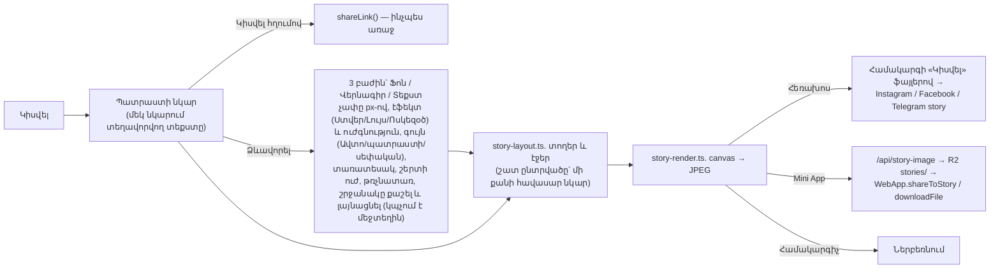

- Ֆոները՝ 7 ձևավորում (գմբեթ, ջահ, մոմ, խաչ, կանթեղ, եկեղեցի, զանգակատուն), ամեն մեկը մուգ և բաց՝
  `public/story-bg/<ձևավորում>-<dark|light>.webp` (+ `thumbs/`). ստեղծվում են
  `python3 -I scripts/make-story-backgrounds.py <թղթապանակ>`-ով (ֆայլի անունը՝ `dome-dark.png` և այլն)։
  Նոր ձևավորումը ավելացնել նաև `app/utils/story-backgrounds.ts`-ի `STORY_DESIGNS`-ում՝ իր `box`-ով։
- Փոխել չի կարելի. վերնագիրը, էջի համարը (1/2) և **apostolic.am**-ը (նկարված է հենց ֆոնի վրա)։ Տեքստը մնում է
  ձևավորման `box`-ի ներսում. վերևում story-ի կոճակների տեղը, ներքևում apostolic.am-ը, և զարդը (մոմ, խաչ…) չի ծածկվում։
- Աղոթքի տեքստը՝ ձևավորման `prayer` պարբերությունները (`prayerParagraphs`), սաղմոսինը՝ `psalmBodyText`։
- Տեքստը բաժանվում է հատվածների (`storyUnits`. պարբերություն/համար, երկարը՝ նախադասություններով)։ «Որքան տեքստ».
  միշտ սկզբում՝ այնքան հատված, որքան տեղավորվում է տեքստի շրջանակում (`fitCount`), մնացածի տեղում «…»
  (`joinUnits`). **Ամբողջը**՝ մի քանի նկար (կրկին սեղմելիս՝ ետ). **Ընտրել…**՝ ձեռքով։
- Տեքստի շրջանակը (`StoryLayout.frame`) ընթերցողը քաշում է և 5 կետով լայնացնում/նեղացնում (`frameHandles`), վերնագիրը՝
  տեղափոխում։ Երկուսն էլ մնում են `SAFE` գոտում. apostolic.am-ը միշտ բաց է։ Նոր ֆոն ընտրելիս՝ նրա սկզբնական
  դասավորությունը (`defaultLayout`)։
- Վերնագիրը և տեքստը ունեն առանձին կարգավորումներ (`StoryStyle.title`/`text`). չափը «պիքսելներով» (տեքստ 10–24,
  վերնագիր 12–32, նկարում ×3՝ `STORY_SCALE`), **էֆեկտ** (`paintLine`. Ստվեր՝ մուգ ստվեր ցանկացած գույնի տառերին, Լույս՝ տառի
  գույնով լուսապսակ, Ոսկեզօծ՝ մեղմ ոսկու երանգ) և նրա **ուժգնությունը** (`strength`, 0–100%), գույն (`story-color-picker.tsx`. «Ավտո»՝ ֆոնի պայծառությունը հենց այդ մասի տակ, պատրաստի գույներ,
  վերջինները՝ `story-colors`, սեփականը՝ պայծառության քառակուսի + երանգ + HEX), տառատեսակ, տակի շերտի ուժ (0–100%)։
- Աղոթքի առաջին տառը՝ **թռչնատառ** (Trchnatar, ինչպես կայքում), 2 տող բարձրությամբ, տողերը նահանջում են
  (`StoryCap`) և սկսվում են հենց տառից հետո. մեջտեղով հավասարեցնելիս «տառ + տողեր» խումբը միասին է կենտրոնացվում։
  Անջատվում է «Տեքստ»-ում։
- Վերնագիրը տեքստի մեջ չի կրկնվում (`withoutLeadingTitle`, ձևավորման միայն `text` պարբերությունները)։ Երկար
  պարբերությունը կտրվում է միայն վերջակետով (։ կամ :), ոչ թե ՜ ՛ ՞ նշաններով։
- Սաղմոսի նկարի վերնագիրը՝ միայն «Սաղմոս N»։ Էջի համարը (1 / 2)՝ տեքստի տակ, շերտից դուրս. շերտը գրկում է հենց
  տեքստը, ոչ թե ամբողջ շրջանակը։
- Քաշելիս երևում է ցանց և մեջտեղի գծերը. վերնագիրը և շրջանակը կպչում են մեջտեղին (`SNAP`)։
- Mini App-ում Telegram-ը ընդունում է միայն հղում, դրա համար նկարը բեռնվում է `/api/story-image` (միայն Telegram-ով մտած,
  JPEG, ≤3 ՄԲ) և տրվում `/story/<id>.jpg`-ով. 2 օրից ջնջվում է (`app/data/stories.server.ts`, գիշերային cron)։
- Ընթերցողի ընտրությունները հիշվում են բրաուզերում (`localStorage` `story-style-v5`)։

## 18. Բազա (D1). բոլոր աղյուսակները

```mermaid
erDiagram
  app_users ||--o{ saved_materials : "պահում է"
  app_users ||--o{ saved_verses : "պահում է"
  app_users ||--o{ highlights : "նշում է"
  app_users ||--o{ reading_log : "նշում է"
  app_users ||--o{ reading_reminders : "դնում է"
  app_users ||--o{ reminder_inbox : "ստանում է"
  app_users ||--o{ push_subscriptions : "բրաուզերներ"
  app_users ||--o{ poll_votes : "քվեարկում է"
  app_users ||--o{ place_visits : "այցելել է"
  app_users ||--o{ liturgy_marks : "Պատարագ"
  app_users ||--o| user_settings : "կարգավորումներ"
  app_users ||--o{ yearly_summaries : "տարվա ամփոփում"
  app_users ||--o{ account_links : "Google↔Telegram"
  app_users ||--o| admin_access : "իրավունքներ"
  app_users ||--o{ place_submissions : "առաջարկում է"
  library_topics ||--o{ library_materials : "բաժին"
  library_materials ||--o{ library_material_blocks : "տեքստի բլոկներ"
  library_materials ||--o{ library_media : "մեդիա"
  library_materials ||--o{ material_attachments : "կայքից ավելացված"
  library_materials ||--|| library_search_documents : "որոնում"
  library_materials ||--o{ psalm_timings : "տող↔ձայն"
  library_materials ||--o| material_layouts : "աղոթքի ձևավորում"
  places ||--o{ place_visits : ""
  places ||--o{ place_submissions : "փոփոխություններ"
```

| Խումբ | Աղյուսակներ |
| --- | --- |
| **Գրադարան** (sync-ը լցնում է) | `library_sources`, `library_topics`, `library_materials`, `library_material_blocks`, `library_media`, `library_album_members`, `library_search_documents`, `library_publishers`, `library_post_authors`, `material_attachments`, `psalm_timings`, `material_layouts` (ադմինի ձևավորում, սինքը չի ջնջում) |
| **Sync-ի հաշվառում** | `library_sync_cursors`, `library_sync_runs`, `library_sync_failures` |
| **Մարդիկ** | `app_users`, `account_links`, `admin_access`, `user_settings` |
| **Անձնական** | `saved_materials`, `saved_verses`, `highlights`, `reading_log`, `poll_votes`, `place_visits`, `liturgy_marks`, `yearly_summaries` |
| **Հիշեցումներ** | `reading_reminders`, `reminder_inbox`, `reminder_sound_sent`, `push_subscriptions` |
| **Սրբավայրեր** | `places`, `place_submissions`, `bot_place_drafts`, `place_blocklist`, `place_rejected` (հին՝ `sacred_places`, `sacred_place_submissions`, `sacred_place_photos`) |
| **Բառարան** | `glossary_terms` |
| **Կայք** | `site_settings` (քեշի epoch…), `site_presence` (անանուն այցեր), `search_query_aggregates`, `video_optimizations` (սեղմված տեսանյութեր), `client_errors` (բրաուզերի սխալներ, անանուն, 30 օր) |
| **Telegram** | `telegram_bot_updates`, `telegram_group_integrations`, `telegram_review_items`, `telegram_hashtag_mappings`, `telegram_post_category_mappings` |
| **Հին (առաջին տարբերակից)** | `categories`, `materials`, `telegram_sources`, `telegram_topics`, `telegram_imports` |

Բազայի ամեն փոփոխություն՝ `migrations/00NN_*.sql` ֆայլ (այժմ 51 հատ), կիրառվում է deploy-ի ժամանակ։
**Միայն ավելացնող migrations**. migration-ը կիրառվում է նոր կոդից առաջ, և smoke-ի ձախողման դեպքում Worker-ը վերադառնում է հին կոդին, ուստի հին կոդը պետք է աշխատի նոր բազայով։ Սյուն ջնջել/վերանվանել՝ երկու թողարկումով (նախ կոդը դադարում է օգտագործել, հետո migration)։ Migration-ից առաջ deploy-ը գրում է D1 Time Travel-ի bookmark-ը (job-ի Summary)՝ `wrangler d1 time-travel restore <db> --env <միջավայր> --bookmark <…>`։
**Ինչպես նայել՝ ինչքան է լցված**. Կառավարում → Կայքի վիճակը → «D1 ընդհանուր պահեստ» (պետք է token-ին D1 Read իրավունք),
կամ Cloudflare → Storage & Databases → D1 → բազան → **Metrics** (չափը) և **Console** (աղյուսակներ)։

## 19. Պահեստ (R2)

| Թղթապանակ | Ինչ |
| --- | --- |
| մեդիա (sync-ից) | Telegram-ի ձայնագրություններ, տեսանյութեր, նկարներ, դրանց մանրապատկերներ |
| `places/` | Սրբավայրերի նկարներ և տեսանյութեր |
| `thumbs/places/` | Սրբավայրերի փոքր պատկերներ (`?w=160|320`, `place-media.ts`). պատրաստում է Cloudflare Images-ը (`IMAGES` binding) առաջին անգամ, հետո՝ R2-ից. սխալի դեպքում տրվում է բնօրինակը |
| `thumbs/v1/`, `thumbs/og/` | Telegram-ի նկարների և հղման քարտերի փոքրացված WebP-ները (800 px)՝ ցանկերի քարտերի և նյութի էջի համար. `/media/…?w=800`, `/og/card/…?w=800` (`app/data/image-thumb.server.ts`, `storedThumb`). հաջող փոքրացված տարբերակը պահվում է R2-ում (Cloudflare Images, `IMAGES` binding)։ Չշահավետ փոխարկումը նշվում է `.skip`-ով. սխալի կամ ծառայության սահմանի դեպքում տրվում է բնօրինակը։ Տարբեր worker-ների միաժամանակյա առաջին հարցումները կարող են կրկնել փոխարկումը։ Հղման քարտի փոքր պատկերի անվան մեջ բնօրինակի etag-ն է (քարտը վերանկարվում է նույն բանալիով) |
| `help/` | Օգնության (ուսուցողական) տեսանյութեր |
| `submissions/` | Առաջարկների նկարներ (մաքրվում են 30 օր հետո) |
| `og/` | Հղումների քարտեր |
| `search/` (կամ նման) | Որոնման պատրաստ ինդեքսը հեռախոսների համար |
| `originals/` | Տեսանյութի բնօրինակը սեղմման ընթացքում. ջնջվում է նույն աշխատանքում, ստուգումից հետո (տես §4, «Տեսանյութերի ավտոմատ սեղմում») |
| `stories/` | Mini App-ի story-ի ժամանակավոր նկարները, 2 օր (տես §17, «Նկարով կիսվել») |

Ֆայլի բանալին չի փոխվում. փոփոխված ֆայլը ստանում է նոր բանալի, դրա համար ֆայլերը կարելի է անվերջ քեշել։
Միակ բացառությունը՝ սեղմված տեսանյութը նույն բանալիով, բայց նոր `r2_etag`-ով (հղման `?v=`-ը փոխվում է)։
Ճշգրիտ բաժանումը՝ Կառավարում → Կայքի վիճակը → «Ինչով է լցված պահեստը»։ Պահուստային պատճենները (D1, գաղտնագրված)
առանձին փակ բաքեթում են։

## 20. Միջավայրեր և թողարկում

```mermaid
flowchart LR
  BR["Ճյուղ feat/… fix/… chore/…"] -->|"QA review (lint, tsc, թեստեր)"| PR["PR → main"]
  PR -->|"Deploy. build → թեստեր → tsc/lint → bookmark → migrations → deploy → smoke"| PROD["apostolic.am<br/>իր D1 + R2"]
  PROD -->|"smoke-ը ձախողվեց"| RB["wrangler rollback<br/>(նախորդ տարբերակը)"]
  PR -->|"նույն ճյուղը merge"| ST["staging ճյուղ"] -->|"Deploy + smoke"| STS["staging.apostolic.am<br/>իր D1 + R2"]
```

Smoke ստուգումը՝ `scripts/smoke.mjs <հասցե>`. գլխավոր, `/psalms`, `/pray`, մեկ սաղմոս, sitemap, robots, `/api/content-version` և էջի JS/CSS ֆայլերը, ամեն մեկը մինչև 4 փորձ։ Կարելի է աշխատեցնել նաև ձեռքով։

Մանրամասն՝ `docs/ENVIRONMENTS.md`, `docs/deployment-runbook.md`։ Աշխատանքը բաժանված է 3 չատի միջև՝ `docs/work/`։

## 21. GitHub Actions

| Workflow | Երբ | Ինչ |
| --- | --- | --- |
| `deploy.yml` | push `main`/`staging` (ոչ `.md`, ոչ `docs/`) | build, թեստեր, tsc/lint (պռոդ), D1 bookmark, migrations, deploy, smoke, ձախողվելիս՝ rollback |
| `og-cards.yml` | պռոդի deploy-ից հետո, ձեռքով | հղումների քարտեր |
| `cloud-sync.yml` | Clock-ից, շաբաթական, ձեռքով | Telegram → D1/R2, հետո տեսանյութերի սեղմում |
| `qa.yml` | PR | lint, typecheck, թեստեր (`bash scripts/check.sh`-ը նույնն է անում տեղում) |
| `private-backup.yml` | շաբաթական | D1-ի գաղտնագրված պատճեն |
| `diagnose-topic.yml` | ձեռքով | մեկ թեմայի ախտորոշում |
| `staging-reset.yml` | staging, իր ֆայլերի փոփոխություն | staging-ը՝ ամեն բաժնից 1 նյութ + 1 տեսանյութ + 1 ձայնագրություն, ավելորդ մեդիան ջնջվում է staging-ի պահեստից |
| `staging-osm-places.yml` | staging, իր ֆայլի փոփոխություն | OSM ներմուծում staging-ում |
| `storage-report.yml` | ձեռքով | միայն կարդում է. R2 և D1-ի ամբողջական հաշվետվություն (Summary-ում) |

Ռեպոն փակ է (2026-11-02-ից). անվճար սահմանը 2000 րոպե ամսական, երևում է «Կայքի վիճակը» էջում։

## 22. Արագություն և խնայողություն

- Անանուն էջերը քեշվում են Cloudflare-ում (stale-while-revalidate, բաժին 3)։ Բովանդակության տարբերակը cache-ի բանալու մեջ չէ, այլ `X-Stored-Version` header-ում (`workers/app.ts`). նոր/փոփոխված գրառումից հետո գրադարանի էջը տրվում է անմիջապես, թարմը պատրաստվում է հետևում։ «Թարմացնել կայքը» (epoch) և ոչ գրադարանային էջերը (places, search…) թարմանում են միանգամից։
- Ցանկի գրառումների մեդիան բազայից մեկ `db.batch()`-ով (`hydrateRows`, `cloud-library.server.ts`). հաջորդական հարցումներ ցիկլում չանել. սաղմոսի էջը դրանից 2 վ էր։
- Թռչնատառը (Trchnatar, 250 ԿԲ) բաժանված է 38 ֆայլի (~9 ԿԲ) `unicode-range`-ով (`scripts/split-trchnatar.py` → `app/trchnatar-faces.css`). բեռնվում է միայն պետք եղած տառը։
- **Անվերջ անիմացիաներ չկան** (2026-11-25). մենյուի կոճակի պսակը առաջ անընդհատ պտտվում էր, ու հեռախոսը ամեն էջում վայրկյանում 60 անգամ նորից էր նկարում էկրանը (անգործ վիճակում 3 վրկ-ում 180 կադր → 0)։ Հիմա պսակը պտտվում է միայն մենյուն բացելիս (`transition`, `site-nav.tsx`), բեռնվող նկարի փայլը՝ 6 անգամ (~9 վրկ)։ Նոր անվերջ (`infinite`) անիմացիա չավելացնել։
- **Մուտքի անիմացիաները՝ `backwards`, ոչ `both`** (`rise-in`, `hero-rise`, `menu-view`, `ti-draw`…). `both`-ով ավարտված անիմացիան տարրը պահում էր առանձին GPU շերտ. «Ավետարանում» ամեն քարտ (86 շերտ), հեռախոսի գրաֆիկական հիշողությունը լցվում էր։ `both`/`forwards`՝ միայն «դուրս գալու» անիմացիաներին, որոնց վերջում տարրը պետք է թաքնված մնա։
- Բեռնվող նկարի և կմախքի փայլը՝ միայն `opacity`-ով (`.reveal-frame::before`, `.page-bone`, `app.css`), որը վիդեոքարտն է անում։ `background-position`, `width`, `top` և նման հատկություններ անվերջ անիմացիայում ՉՕԳՏԱԳՈՐԾԵԼ. «Ավետարանի ուսուցում»-ում 23 չբեռնված նկարի փայլը վայրկյանում ~1400 անգամ վերանկարում էր էջը (ոլորելիս նկարելը 517 → 34 մվ, 2026-11-25)։
- Թղթի հատիկը պատրաստի `paper-grain.webp` է (SVG `feTurbulence` ֆիլտր չօգտագործել ֆոնում. ամեն բացման ժամանակ նկարվում է)։ Զարդային նկարները (`fetchPriority="low"`) React-ի preload չեն ստանում։
- Նյութի էջի առաջին նկարը (`priority`, `telegram-content.tsx` / `MaterialMediaGallery`) `eager` է, առանց թափանցիկ նախնական պատկերի։
- Worker-ը աշխատում է D1-ին մոտ (Smart Placement). cache-ում չեղած էջի SQL հարցումները կարճ են։
- Ձայնագրությունը բեռնվում է միայն «Լսել»-ից հետո. մեծ նկարները ունեն 560/880/1200/1774px տարբերակներ (`app/assets/responsive.ts`), հրեշտակը՝ 240/540 (`home.tsx`), մենյուի պսակը՝ 112/168 (`site-nav.tsx`)։ Նոր նկարին՝ նույնպես փոքր տարբերակ + `srcSet`/`sizes`։
- Cache-ից տրվող էջը բազային չի դիմում. բովանդակության տարբերակը պահվում է Cloudflare-ի cache-ում 15 վ (`edgeContentVersion`, `workers/app.ts`), `bumpCacheEpoch`-ը այն ջնջում է։ Root loader-ի բազայի հարցումները զուգահեռ են։
- Էջի գլխավոր նկարը (`ArtImage` + `fetchPriority="high"`) `reveal-img` չունի՝ միանգամից է երևում (LCP)։
- Բառարան, նշումներ, հիշեցման զանգ, կիրակնօրյա հարց՝ առանձին JS ֆայլեր, բեռնվում են էջը բացվելուց հետո (`useIdleReady`, `root.tsx`)։ Նման «ամբողջ կայքի» նոր շերտը՝ նույն ձևով։
- `ArianGrqi` տառատեսակը կրճատված է (միայն հայերեն, լատիներեն, կետադրություն; 100 → 22 ԿԲ, `pyftsubset`)։ Նոր տառատեսակ ավելացնելիս՝ նույնը։
- Ստուգում՝ `lighthouse https://apostolic.am/` (cloud-ում `CHROME_PATH=/opt/pw-browsers/chromium`)։
- Սրբավայրերի ցանկը և քարտեզի նշանները՝ փոքր պատկերներով (`placeThumbUrl`)։
- Բաժինների ցանկերի քարտերը (`/daily`, `/saints`, `/gospel`) և նյութի էջի նկարը՝ 800 px WebP (`mediaCardUrl`, `gospelVideoCover(post, true)`, `preview.imageUrl`, `media.displayUrl`). բնօրինակը (`media.url`) բացում է միայն ամբողջ էկրանով դիտիչը և հղման նախադիտումը։ Նոր ցանկում նկար ցույց տալիս՝ նույն հասցեներով, ոչ թե `mediaUrl`-ով։
- Հեռախոսը պահում է էջերը և որոնման ինդեքսը, մինչև բովանդակության տարբերակը փոխվի։
- Մեդիան ուղիղ R2-ից, անփոփոխ բանալիներով, տարի քեշով։
- Sync-ը միայն նոր գրառումից 15 րոպե հետո (մի քանի գրառում՝ մեկ sync), գումարած գիշերը։
- Ոչ մի «ամեն րոպե» աշխատանք. Clock-ը արթնանում է միայն գործ ունենալիս։
- Որոնման դասավորումը SQL-ում, ոչ թե Worker-ում (CPU)։
- Քարտերը նկարվում են GitHub-ում, միայն փոփոխվածները։
- **Liquid glass-ը հանված է** (2026-11-25, `docs/DESIGN.md` բաժին 2). քարտեր, մենյու, պատուհաններ՝ «թուղթ»
  (կիսաթափանց կամ անթափանց ֆոն, 0.5px եզր, մեկ ստվեր), առանց `backdrop-filter`-ի, դիմակների և շերտավոր ստվերների։
  Մենյուն բացել-փակելիս GPU-ի աշխատանքը մեկ կադրում 5,7 → 2,1 մվ (նույն տվյալներով, տեղական չափում)։
- **Թեմայի փոխումը** (`theme.ts`, `applyThemePreference`) միանգամից է. View Transition-ը և ամբողջ էջի կրկնակի ոճերի
  հաշվարկը (`data-theme-switching`) հանված են, կոճակների գույնի անցումները ավարտվում են անմիջապես
  (`finishColorTransitions`)։ Ոճերի հաշվարկը թեման փոխելիս 120–195 → 31–57 մվ (CPU ×4)։

## 23. Թղթապանակների քարտեզը

```mermaid
flowchart TD
  ROOT["ռեպո"] --> APP["app/ — կայքը"]
  APP --> RT["routes/ — էջեր և API (մեկ ֆայլ՝ մեկ հասցե)"]
  APP --> CMP["components/ — էջերի մասեր (նավիգացիա, քարտեզ, սկիհ…)"]
  APP --> DAT["data/ — բազայի և արտաքին ծառայությունների հետ աշխատանք (*.server.ts)"]
  APP --> UT["utils/ — մաքուր հաշվարկներ (ամսաթիվ, ուղիներ, տոներ…)"]
  APP --> AU["auth/ — մուտք, իրավունքներ"]
  APP --> CSS["app.css — ոճեր, թեմաներ, անիմացիաներ"]
  ROOT --> WK["workers/ — app.ts (մուտքի կետ), clock.ts (ժամացույց)"]
  ROOT --> SH["shared/ — ընդհանուր կոդ"]
  ROOT --> MG["migrations/ — բազայի փոփոխություններ"]
  ROOT --> TS["tests/ — թեստեր"]
  ROOT --> SC["scripts/ — sync, քարտեր, OSM, լոգո…"]
  ROOT --> SV["services/ — Telegram Bridge (տեղական/MTProto)"]
  ROOT --> GHW[".github/workflows/ — Actions"]
  ROOT --> DOC["docs/ — փաստաթղթեր, docs/work/ — չատերի աշխատանքը"]
  ROOT --> WR["wrangler.jsonc — Cloudflare-ի կարգավորումներ (D1, R2, cron)"]
```

## 24. Կարևոր բանաձևեր և ֆունկցիաներ

Այստեղ կայքի «ուղեղի» փոքր, բայց կարևոր մասերն են. փոխելիս սկսեք այս ֆունկցիաներից և դրանց թեստերից (`tests/`)։

### Երևանի օրը
Ամբողջ կայքը օրերը հաշվում է Երևանի ժամով (UTC+4, առանց ամառային ժամի)։ `app/utils/liturgy.ts`
```ts
const YEREVAN_MS = 4 * 3_600_000;
export function yerevanDay(now = Date.now()) {
  return new Date(now + YEREVAN_MS).toISOString().slice(0, 10); // «2026-11-02»
}
```

### Զատիկի օրը (Գաուսի/Meeus-ի բանաձև)
Շարժական տոները հաշվվում են Զատիկից։ `app/utils/liturgy.ts` · ⚑ Ճշտել հոգևորականի հետ
```ts
export function easterDay(year: number) {
  const a = year % 19, b = Math.floor(year / 100), c = year % 100, d = Math.floor(b / 4), e = b % 4;
  const f = Math.floor((b + 8) / 25), g = Math.floor((b - f + 1) / 3), h = (19 * a + b - d - g + 15) % 30;
  const i = Math.floor(c / 4), k = c % 4, l = (32 + 2 * e + 2 * i - h - k) % 7, m = Math.floor((a + 11 * h + 22 * l) / 451);
  const month = Math.floor((h + l - 7 * m + 114) / 31);
  const day = ((h + l - 7 * m + 114) % 31) + 1;
  return `${year}-${month}-${day}`; // իրականում՝ երկնիշ ամիս/օր
}
```

### Տոները և «Պատարագի օրը»
```ts
// հաստատուն տոներ + Զատիկ−3 (Ավագ Հինգշաբթի) + Զատիկ+39 (Համբարձում)
export function feastOn(day: string): string | null
// կիրակի կամ տոն
export function isLiturgyDay(day: string) {
  return new Date(`${day}T00:00:00Z`).getUTCDay() === 0 || feastOn(day) !== null;
}
```
Նոր տոն ավելացնել՝ `feastOn`-ի `fixed` ցուցակում («ամիս-օր»: «անուն») կամ Զատիկից հեռավորությամբ։

### Ո՞ր օրվա մասին հարցնել
```ts
export function sundayToAsk(now = Date.now()) {
  const local = new Date(now + YEREVAN_MS);
  const today = local.toISOString().slice(0, 10);
  if (local.getUTCHours() >= 13 && isLiturgyDay(today)) return today;   // «Այսօր…»
  const yesterday = shift(today, -1);
  return isLiturgyDay(yesterday) ? yesterday : null;                     // «Երեկ…»
}
```
Ժամը (13) փոխել՝ այստեղ և cron-ը `wrangler.jsonc`-ում (`7 9 * * SUN` = 09:07 UTC = 13:07 Երևան)։

```mermaid
stateDiagram-v2
  state "Հարց չկա" as none
  state "«Այսօր մասնակցե՞լ եք…»" as today
  state "«Երեկ մասնակցե՞լ եք…»" as yesterday
  state "Պատասխանված" as answered
  state "Անջատված" as off
  [*] --> none
  none --> today: կիրակի կամ տոն, 13.00-ից
  today --> yesterday: կեսգիշեր (Երևան)
  yesterday --> none: հաջորդ կեսգիշեր
  today --> answered: Այո / Այս անգամ ոչ
  yesterday --> answered: Այո / Այս անգամ ոչ
  today --> off: Չհարցնել այլևս
  answered --> [*]
```

### Ձեռքով նշում՝ վերջին 30 օրը
```ts
export function canMarkDay(day: string, now = Date.now()) {
  const today = yerevanDay(now);
  return day <= today && day >= shift(today, -30); // ապագա՝ ոչ, 30 օրից հին՝ ոչ
}
```

### Sync-ի ուշացումը
`workers/clock.ts` · `SYNC_DELAY_MS = 15 * 60_000`. ամեն նոր գրառում զարթուցիչը տանում է 15 րոպե առաջ, այնպես որ 10 գրառում իրար հետևից՝ մեկ sync։

```mermaid
gantt
  dateFormat HH:mm
  axisFormat %H:%M
  section Գրառումներ
  Գրառում 1 :milestone, 10:00, 0m
  Գրառում 2 :milestone, 10:05, 0m
  Գրառում 3 :milestone, 10:09, 0m
  section Զարթուցիչ
  սպասում (ամեն գրառում վերսկսում է) :active, 10:00, 24m
  Sync (մեկ անգամ) :crit, 10:24, 3m
```

### Քեշի «epoch»
`app/data/site-refresh.server.ts` · `site_settings.cache_epoch`. թիվ, որը մտնում է քեշի բանալու մեջ `contentVersion`-ի միջոցով (`epoch.վերջին_գրառման_ժամը`, `content-version.server.ts`)։ «Թարմացնել կայքը» կամ գրառման ցանկացած փոփոխություն փոխում է այն → բոլոր հին պատրաստ էջերը այլևս չեն գտնվում և վերակառուցվում են։

### Բառարանի բառի նորմալացում
`app/utils/glossary.ts`. դասական և նոր ուղղագրությունները բերում է նույն ձևի, որ «ամբարշտութիւն» և «ամբարշտություն» նույնը գտնվեն.
```ts
export function normalizeWord(word: string) {
  return word.toLocaleLowerCase("hy")
    .replace(/և/gu, "եւ").replace(/ու/gu, "\u0001").replace(/իւ/gu, "յ\u0001")
    .replace(/ւ/gu, "վ").replace(/\u0001/gu, "ու").replace(/է/gu, "ե").replace(/օ/gu, "ո");
}
```

### Սաղմոսի համարը
`app/utils/psalm-number.ts`. փնտրում է «Սաղմոս 41»-ը ձայնագրության անվան, վերնագրի, հետո տեքստի մեջ, ընդունում է 1–151։

### GitHub-ի րոպեները
`app/data/github-usage.server.ts`. ամեն գործարկում՝ `ceil((ավարտ − սկիզբ) / 60 վ)`, գումարը այս ամսվա, սահմանը 2000։

### Պահպանման ժամկետներ (մաքրում)
`app/data/retention.server.ts`, ամեն գիշեր.
| Ինչ | Ժամկետ |
| --- | --- |
| Չուղարկված սրբավայրի սևագիր | 1 օր |
| Թիմի կողմից մշակված առաջարկ (պռոդ) | 30 օր |
| Staging-ի թեստային տվյալներ | 3 օր (`TEST_DATA_DAYS`) |
| Հին տարիների Պատարագի նշումներ | ամփոփվում են `yearly_summaries`-ում |
| Mini App-ի story-ի նկարներ (R2 `stories/`) | 2 օր (`app/data/stories.server.ts`) |
| Բրաուզերի սխալներ (`client_errors`) | 30 օր (վերջին տեսնելուց) |

## 25. Ինչպես փոխել. բաղադրատոմսեր

### Նոր էջ
1. Ստեղծել `app/routes/my-page.tsx` (`loader` տվյալի համար, `default` կոմպոնենտ էջի համար, `meta` վերնագրի համար)։
2. Գրանցել `app/routes.ts`-ում՝ `route("my-page", "routes/my-page.tsx")` (**կոնկրետ հասցեները՝ `:section`-ից առաջ**)։
3. Եթե պետք է մենյուում՝ `app/components/site-nav.tsx`։
4. Թարմացնել այս ֆայլի «Էջերի քարտեզը»։

### Նոր աղյուսակ կամ սյունակ բազայում
1. Նոր ֆայլ `migrations/00NN_name.sql` (հաջորդ համարը), երբեք չփոխել հինը։
2. Լոկալ՝ `npm run db:migrate:local`։
3. Կոդը պետք է աշխատի և՛ հին, և՛ նոր բազայի հետ (deploy-ը նախ migration է անում, հետո նոր կոդ)։
4. Եթե անձնական տվյալ է (`user_id`)՝ ավելացնել `account-links.server.ts`-ի ցուցակում (Google↔Telegram միացման համար)։
5. Թարմացնել «Բազա» բաժինը։

### Նոր API
`app/routes/my-api.ts` (միայն `loader`/`action`, առանց կոմպոնենտի) + `routes.ts`-ում `route("api/my-api", …)`։ Ձևերի համար՝ `requireSameOrigin`, իրավունքների համար՝ `requireOwner` / `requirePermission`։

### Նոր տոն կամ ժամի փոփոխություն
`app/utils/liturgy.ts` (`feastOn`, `sundayToAsk`) + `tests/liturgy.test.ts`։ Cron-ը՝ `wrangler.jsonc` (`triggers.crons`, երկու միջավայրում)։

### Նոր գաղտնի բանալի (secret)
Կոդում՝ `env.MY_SECRET`. արժեքը դնում է տերը Cloudflare-ում (Worker → Settings → Variables and Secrets)։ Երբեք ռեպոյում։ Նշել `docs/ENVIRONMENTS.md`-ում։

### Ոճ, գույն, անիմացիա
`app/app.css` (թեմաները՝ `:root[data-theme="light"|"dark"]`), Tailwind դասերը՝ անմիջապես կոմպոնենտներում։ Կիրակնօրյա պատուհանը՝ `.sunday-*`, սկիհը՝ `chalice-art.tsx`։

### Ստուգել և թողարկել
```bash
npm run dev                      # լոկալ, http://localhost:5173
bash scripts/check.sh            # կախվածություններ, build, թեստեր, tsc, lint՝ կարճ ելքով (նույնը, ինչ QA review-ը)
node scripts/smoke.mjs https://apostolic.am   # կենդանի կայքի արագ ստուգում
node scripts/work-brief.mjs      # մյուս չաթերի աշխատանքը (docs/work/), առանց «Արված»-ի
```
Հետո՝ PR → main (QA-ն կանաչ), merge, հետո նույն ճյուղը staging-ում (բաժին 20)։

```mermaid
flowchart LR
  A["1. Ճյուղ origin/main-ից"] --> B["2. Փոփոխություն + թեստ"] --> C["3. npm run dev՝ աչքով"] --> D["4. scripts/check.sh"] --> F["5. PR → main (QA կանաչ)"] --> E["6. staging merge"] --> G["7. ARCHITECTURE.md թարմ է"]
```

## 26. Բառարան՝ նոր մարդու համար

| Բառ | Ինչ է |
| --- | --- |
| **Worker** | Cloudflare-ի ծրագիր, որ պատասխանում է կայքի ամեն հարցմանը. մեր ամբողջ «սերվերը» |
| **D1** | Cloudflare-ի SQL բազա (SQLite) |
| **R2** | Cloudflare-ի ֆայլերի պահեստ |
| **Durable Object** | Մեկ օրինակով աշխատող փոքր ծրագիր հիշողությամբ. մեզ մոտ՝ Clock զարթուցիչը |
| **Cron** | Ժամանակացույցով գործարկում («ամեն կիրակի 09:07») |
| **Migration** | Բազայի կառուցվածքի փոփոխության ֆայլ, կիրառվում է հերթականությամբ մեկ անգամ |
| **Deploy** | Նոր կոդի տեղադրումը Cloudflare-ում |
| **Staging** | Փորձարկման կայք, իր առանձին բազայով |
| **Webhook** | Telegram-ը ինքն է կանչում մեր հասցեն, երբ բան է պատահում |
| **SSR** | Էջը պատրաստվում է սերվերում, բրաուզերը ստանում է պատրաստ HTML |
| **loader / action** | React Router-ի ֆունկցիաներ. տվյալ բերել / ձև ընդունել |
| **Mini App** | Կայքը Telegram-ի ներսում բացված |
| **initData** | Telegram-ի ստորագրված տվյալը, որով Mini App-ում մարդը ճանաչվում է առանց գաղտնաբառի |
| **MTProto** | Telegram-ի հիմնական արձանագրությունը. թույլ է տալիս կարդալ խմբի ամբողջ պատմությունը |
| **Web Push / VAPID** | Բրաուզերի ծանուցումներ և դրանց ստորագրման բանալին |
| **Open Graph (og)** | Հղման նախադիտման նկար և վերնագիր |
| **Epoch** | Թիվ, որի փոփոխությունը անվավեր է դարձնում ամբողջ քեշը |
| **GitHub Actions** | GitHub-ի ավտոմատ աշխատանքներ (deploy, sync…) |
| **PR (Pull Request)** | Փոփոխությունների առաջարկ մի ճյուղից մյուսը |

### 2026-11-11․ audit-ի ուղղումներ

- Բաժնի որոնումը չեղարկում է նախորդ հարցումը, կարդում է որոնման բոլոր էջերը, կրկնվող cursor-ը մերժում է, 60 վրկ-ից հետո ավարտում է սպասումը։ 503-ը կամ անվավեր JSON-ը ցուցադրվում է որպես սխալ՝ «Կրկին փորձել», ոչ որպես դատարկ արդյունք։
- `storedThumb`-ը նույն worker-ի ներսում միավորում է նույն պատկերի միաժամանակյա փոխարկումները։ Չշահավետ արդյունքի մասին պահում է `.skip` նշում նույն տարբերակի բանալիով. ժամանակավոր սխալը մշտապես չի հիշվում։ Տարբեր worker-ների միջև գլոբալ lock չկա։ Փոքր պատկերի HEAD և GET-ը տալիս են նույն տեսակը և չափը։
- Առանց JavaScript-ի՝ `<noscript>`-ը վերականգնում է էջի սահքն ու `.reveal-img` նկարների տեսանելիությունը։
- `/settings`-ը `noindex, follow` է։ robots.txt-ը թույլ է տալիս կարդալ `/settings` և `/search` էջերի noindex հրահանգները։
- QA workflow-ը նաև պատրաստում է տեղական փորձնական բազա և պատրաստ build-ը բացում `vite preview`-ով և գործարկում Chromium-ի `scripts/qa-ui-smoke.mjs`-ը՝ մրցակցող որոնումների, սխալների, էջավորման, modal-ի և առանց JavaScript-ի աշխատանքի ստուգումներով։

- Բառային որոնումը բերում է միայն համընկնումները՝ առանց բաժնի բոլոր նյութերի նախնական ներբեռնման։ Թվով սաղմոս որոնելիս համարը համեմատվում է ճշգրիտ, այդ թվում՝ դեռ չբեռնված նյութերի համար։
- Հանրային հիշողության cache-ը մեկ բազայի և տարբերակի նույն բանալիով ընթացիկ հարցումները միավորում է։ Առավելագույնը 400 պատրաստ արդյունք է պահում։ Տարբեր բազաները մեկուսացված են։ Տարբերակի միաժամանակյա SQL ընթերցումները նույնպես միավորվում են։ Սա չի փոխում անձնական տվյալների cache-ի կանոնները։
- Service worker-ի օրական տվյալների թարմությունը ստուգվում է Երևանի օրով՝ անկախ ընթերցողի ժամային գոտուց։
- Լսված աուդիոն (ոչ վիդեոն) service worker-ը ամբողջությամբ պահում է `audio-v1` քեշում (մինչև 150 ֆայլ). էջը `keep-audio` հաղորդագրություն է ուղարկում `onPlaying`-ի ժամանակ, ֆայլը վերցվում է կայքի `/media/...` հասցեից (media.apostolic.am-ը CORS չի տալիս), հետո նվագարկվում է հեռախոսից՝ Range-ով։ Blur (`backdrop-filter`) կայքում չկա (2026-11-12, արագության համար)։
- Մուտք գործած մարդու էջերի HTML-ը անձնական է ու չի պահվում. service worker-ը նույն էջը առանձին բերում է առանց cookie-ի (`keepPublicPage`, օրը մեկ անգամ) և պահում, որ առանց ինտերնետի բացվի։ Առանց ինտերնետի գլխավոր էջը գտնվում է նաև `?source=...`-ն անտեսելով։
- Ադմինը («Բառարան» իրավունքով) տեքստում բառի վրա սեղմելիս պատուհանում տեսնում է «Ավելացնել բառարանում» կոճակը. բացվում է նույն ձևը (`components/glossary-term-form.tsx`, `glossary-term-sheet.tsx`), որը fetcher-ով ուղարկվում է `/admin/glossary` (`stay=1`)։ Blur-ը մնացել է միայն բաց մենյուում։
- Գրառումները (POST) այլևս չեն ջնջում պահված էջերը (`PAGES`), միայն `/auth/logout`-ն է ջնջում։ Service worker-ի տեղադրման ժամանակ գլխավոր էջը նախապես պահվում է առանց cookie-ի։ Քեշում միայն ընդհանուր (անձնական տվյալ չունեցող) էջեր կան։
- Առանց ինտերնետի (`components/offline-bar.tsx`). վերևում «Ինտերնետ չկա» նշում, պահված չեղած էջերի հղումները աղոտ են ու չեն բացվում, պահվածները բացվում են ամբողջ էջով, ինտերնետը վերադառնալիս `revalidate`։ Էջի ցանցային սպասումը 3 վ է, հետո պահված տարբերակը։ Մենյուն այլևս body-ն չի սառեցնում (`lockScroll` չկա). ետևի scroll-ը կանգնեցնում է `touch-action`-ը, իսկ iPhone-ում՝ `touchmove`-ի `preventDefault`-ը (`site-nav.tsx`, թույլ է տալիս միայն մենյուի ներսի ոլորումը և տառաչափի սահիչը)։ Ներսի նավարկման ժամանակ (`.data`) service worker-ը պահում է նաև էջի ընդհանուր HTML-ը (առանց cookie-ի, օրը մեկ անգամ, `pageAddress` + `keepPublicPage`), որ բացված էջերը առանց ինտերնետի բացվեն։ Սրբավայրերի քարտեզի Հայաստանի եզրը `clip-path` է canvas-ի վրա (ոչ թե mask-ի SVG նկար, որը iPhone-ում ամեն շարժման ժամանակ թարթում էր)։

- Yandex Webmaster-ի սեփականության հաստատումը՝ `/yandex_b6a0ffc7e6521155.html` ստատիկ ֆայլով։
